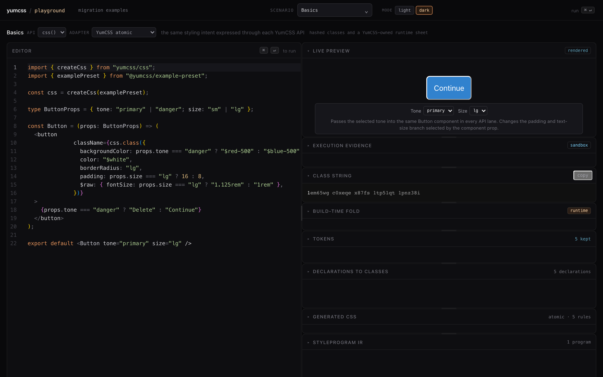
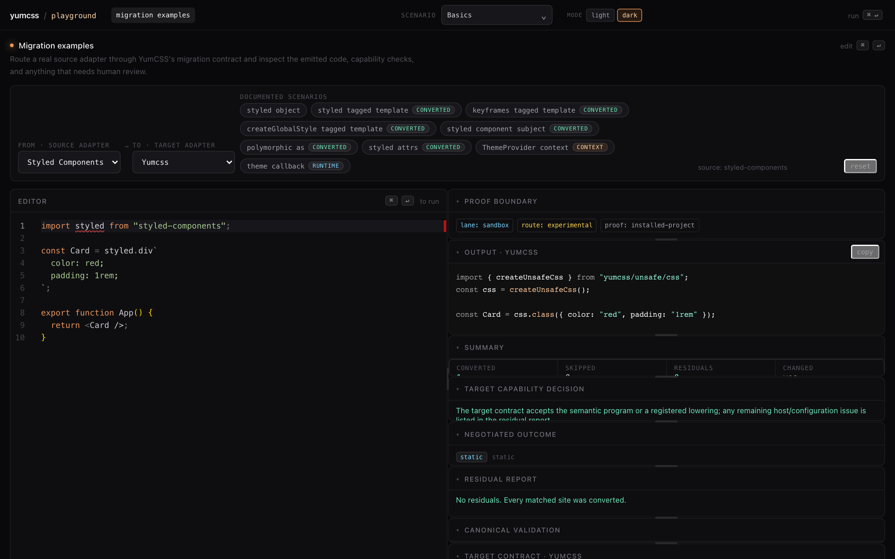
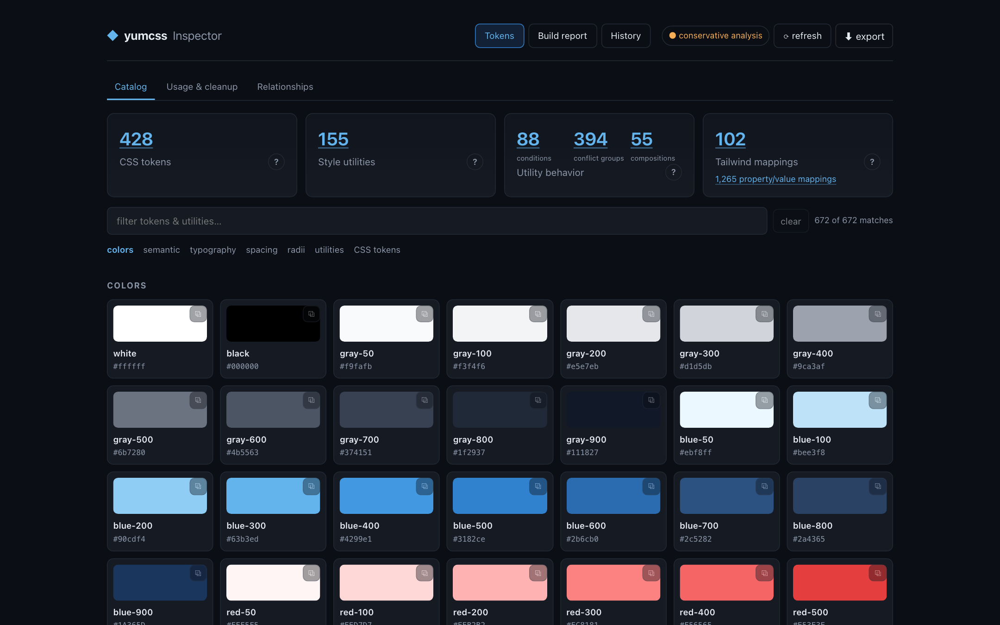
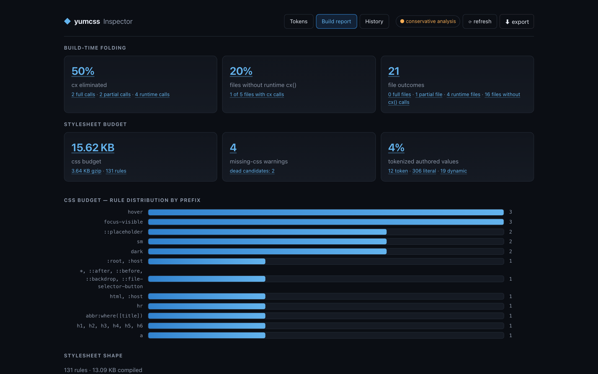

# yumcss

Typed styling for teams that want the confidence of TypeScript without giving
up the CSS tools they already use.

YumCSS checks style objects against a project's real design system and moves
known styles to ordinary CSS classes or an extracted atomic stylesheet. CSS
remains CSS, Tailwind remains Tailwind, and runtime values keep an explicit
escape hatch.

## Start here

| Your task                             | Guide                                                                    |
| ------------------------------------- | ------------------------------------------------------------------------ |
| Write typed CSS objects               | [Getting started](./docs/src/content/docs/start/quick-start.mdx)         |
| Build shared tokens and themes        | [Design-system guide](./docs/src/content/docs/design-system/presets.mdx) |
| Keep Tailwind and add typed utilities | [Tailwind guide](./docs/src/content/docs/tailwind/tw.mdx)                |
| Combine styles from different sources | [Composition guide](./docs/src/content/docs/css/composition.mdx)         |
| Evaluate a migration                  | [Migration guide](./docs/src/content/docs/migrate/overview.mdx)          |

The getting-started guide is the canonical setup and example source. It assumes
an existing Vite app; use the [multi-bundler guide](./docs/src/content/docs/guides/bundlers.mdx)
for other bundlers. The [preset reference](./docs/src/content/docs/design-system/presets.mdx)
lists the core and optional ecosystem presets.

## See it in action

The repository includes a Playground, Inspector, Analyzer, and read-only
Migration Preview. These tools help explore and verify YumCSS; they are
optional workflows, not required setup.

<table>
  <tr>
    <td width="50%">
      
    </td>
    <td width="50%">
      
    </td>
  </tr>
  <tr>
    <td><strong>Playground</strong><br />Change a typed example and inspect the rendered result.</td>
    <td><strong>Migration lab</strong><br />Run real migration adapters and read the residual report.</td>
  </tr>
  <tr>
    <td width="50%">
      
    </td>
    <td width="50%">
      
    </td>
  </tr>
  <tr>
    <td><strong>Inspector</strong><br />Browse tokens, utilities, and generated mappings.</td>
    <td><strong>Build report</strong><br />Measure extraction, stylesheet shape, CSS size, and missing CSS.</td>
  </tr>
</table>

Migration Preview opens a project in a read-only workspace so you can inspect
generated code, residuals, and evidence before editing files.

## How the styling lanes fit

- **Typed CSS objects:** the primary path for new code. YumCSS extracts
  static styles and keeps runtime values explicit.
- **Tailwind utilities:** generated types and build-time folding for projects
  that keep Tailwind as their stylesheet engine.
- **Design vocabulary:** named terms for components that should express intent
  instead of individual CSS properties.
- **Class composition:** combine YumCSS output with ordinary classes and
  styles from other libraries.
- **Migration tools:** preview registered source-to-target routes and preserve
  unsupported behavior as typed residuals.

The [CSS API](./docs/src/content/docs/css/overview.mdx), [design API](./docs/src/content/docs/design-system/design-css.mdx),
[Tailwind API](./docs/src/content/docs/tailwind/tw.mdx), and [composition API](./docs/src/content/docs/css/composition.mdx)
show each lane in detail.

YumCSS is static-first, not universal compilation. Dynamic values use
explicit runtime carriers or Tailwind safelists. Globals, complex selectors,
and framework-owned behavior stay with authored CSS or the host integration
when YumCSS cannot prove a safe representation. See
[current limitations](./docs/src/content/docs/contributing/limitations.md).

## Repository tools

Run these from the repository checkout:

```sh
pnpm run playground
pnpm run inspect
pnpm run analyze
pnpm run migration-preview
```

The [tools section](./docs/src/content/docs/tools/) explains what each tool
shows, with screenshots.

## Documentation

- [Getting started](./docs/src/content/docs/start/quick-start.mdx)
- [Styling with css()](./docs/src/content/docs/css/)
- [Design systems](./docs/src/content/docs/design-system/)
- [Coming from Tailwind](./docs/src/content/docs/tailwind/)
- [API reference](./docs/src/content/docs/reference/)
- [Migration adapters](./docs/src/content/docs/migrate/overview.mdx)
- [Tools](./docs/src/content/docs/tools/)
- [Implementation status](./docs/src/content/docs/contributing/implementation-status.md)
- [Current limitations](./docs/src/content/docs/contributing/limitations.md)

## Work on YumCSS

```sh
pnpm install --frozen-lockfile
pnpm run test
pnpm run typecheck
pnpm --filter yumcss-docs run dev
```

YumCSS is pre-launch. Experimental integrations and bounded proof claims
remain labeled as such; a fixture does not promise universal framework or
migration support.
