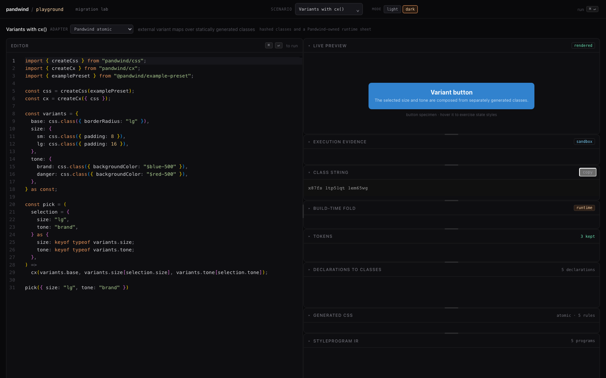
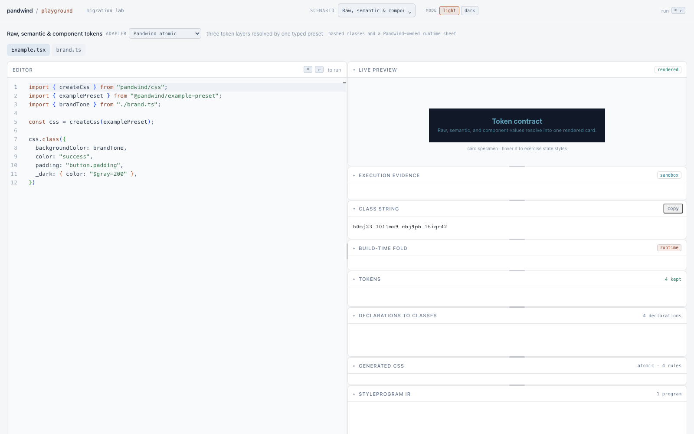
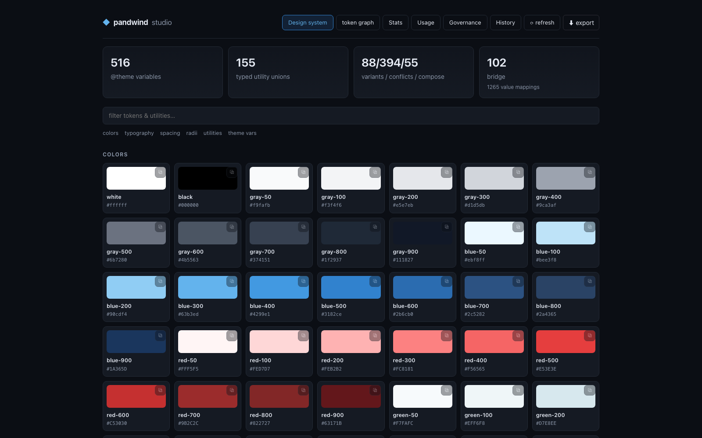
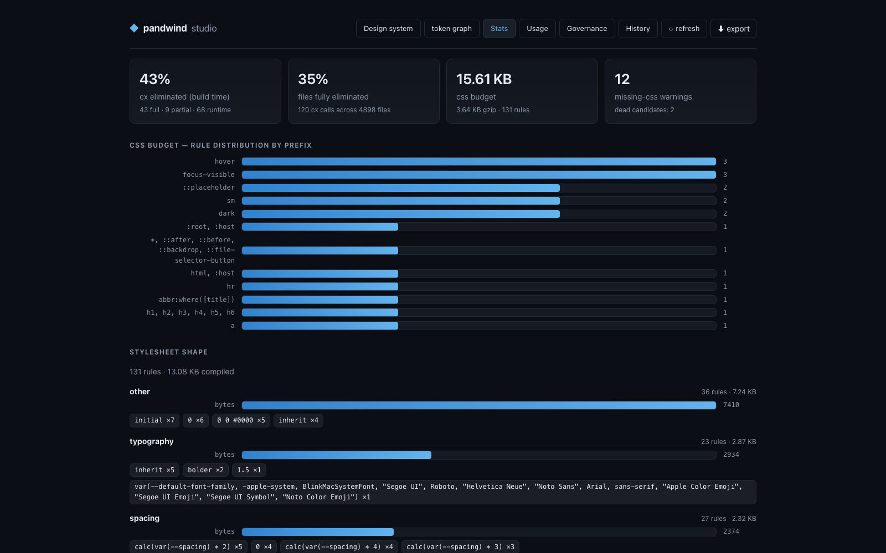
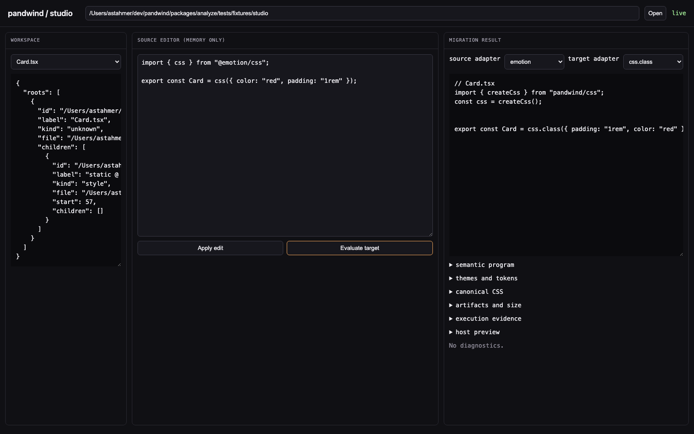

# pandwind

Typed styling for teams that want the confidence of TypeScript without giving
up the CSS tools they already use.

Pandwind lets you describe styles as objects, checks those objects against
your real design system, and turns known styles into ordinary CSS classes or
an extracted atomic stylesheet. Tailwind remains Tailwind. CSS remains CSS.
You get a typed layer on top, plus a clear escape hatch whenever the platform
needs something special.

## Start here

| If you…                                  | Start with                                                       | Why                                                                                          |
| ---------------------------------------- | ---------------------------------------------------------------- | -------------------------------------------------------------------------------------------- |
| want typed CSS objects and atomic output | [`css()`](./docs/src/content/docs/api/css.md)                    | This is the default Pandwind API for new code: CSS objects in, deterministic atomic CSS out. |
| are building a design system             | [`createDesignCss()`](./docs/src/content/docs/api/design-css.md) | Give components a small vocabulary such as `$frame`, `$layout`, and `$text`.                 |
| already use Tailwind                     | [`tw()`](./docs/src/content/docs/api/tw.md)                      | Keep Tailwind's ecosystem while replacing fragile class strings with generated types.        |
| need to combine existing styles          | [`cx()`](./docs/src/content/docs/api/cx.md)                      | Merge Pandwind output, ordinary class strings, and styles from other libraries.              |
| are moving from another library          | [Migration guide](./docs/src/content/docs/guides/migrations.md)  | Preview a conversion, inspect what cannot be translated, then apply it deliberately.         |

## See it in action

The repository includes a live playground, a design-system inspector, analyzer
coverage views, and a migration Studio. These captures come from the running
apps, not mock marketing screens.

<table>
  <tr>
    <td width="50%">
      
    </td>
    <td width="50%">
      
    </td>
  </tr>
  <tr>
    <td><strong>Playground — edit and see the result</strong><br />Change a typed example and inspect the rendered specimen only as deeply as you need.</td>
    <td><strong>Playground — light mode and token layers</strong><br />See raw, semantic, and component token references resolve in a real preview.</td>
  </tr>
  <tr>
    <td>
      
    </td>
    <td>
      
    </td>
  </tr>
  <tr>
    <td><strong>Inspector — understand your system</strong><br />Browse tokens, theme variables, utility unions, and bridge mappings.</td>
    <td><strong>Analyzer — measure what shipped</strong><br />See build-time elimination, stylesheet shape, CSS size, and missing-CSS warnings.</td>
  </tr>
  <tr>
    <td colspan="2">
      
    </td>
  </tr>
  <tr>
    <td colspan="2"><strong>Studio — review a migration before changing files</strong><br />Choose a source and target, inspect the generated code, and see any unsupported behavior instead of guessing.</td>
  </tr>
</table>

## A working CSS setup in five minutes

For a new Pandwind project, start with `createCss(preset)`. It is the primary
authoring API: you write ordinary CSS properties as typed objects and Pandwind
extracts the static part into atomic CSS.

### 1. Install the runtime and build tools

```sh
pnpm add pandwind
pnpm add -D unplugin
```

### 2. Let Vite extract static styles

```ts
// vite.config.ts
import react from "@vitejs/plugin-react-swc";
import { defineConfig } from "vite";
import { pandwindCssVite } from "pandwind/vite";
import { css } from "./src/styles";

export default defineConfig({
	plugins: [pandwindCssVite(css), react()],
});
```

Import the generated stylesheet once from your application entry point:

```ts
import "pandwind:css";
```

### 3. Author typed CSS objects

```ts
// src/styles.ts
import { createCss } from "pandwind/css";
import { defaultPreset } from "pandwind/preset/default";

export const css = createCss(defaultPreset);
```

```tsx
import { css } from "./styles";

export function Card() {
	return (
		<article
			className={css.class({ display: "flex", flexDirection: "column", gap: "4", padding: "6" })}
		>
			Your content
		</article>
	);
}
```

Use `define.preset` when the application needs its own token vocabulary and
property contract. The [design-system guide](./docs/src/content/docs/guides/design-system.md)
builds that contract step by step.

### Choose a preset layer

Pandwind has six intentionally separate preset tiers:

- `csstypePreset` from `pandwind/preset/csstype` is tokenless. It supplies the
  structural CSS and condition contract while your application owns the values.
- `defaultPreset` from `pandwind/preset/default` is the ready-to-use Pandwind
  layer with the stock property-to-token scales and no color palette: bring your
  own colors as literals or tokens.
- `tailwindPreset` from `pandwind/preset/tailwindcss` is the ecosystem layer:
  Tailwind v4's colors, scales, and breakpoints as a preset, generated from the
  installed `tailwindcss` package.
- `chakraPreset` from `pandwind/preset/chakra` is the other ecosystem layer:
  Chakra UI v3's token scales, light / dark semantic color roles, and conditions
  as a preset, generated from the installed `@chakra-ui/react` package.
- `shadcnPreset` / `createShadcnPreset(options)` from `pandwind/preset/shadcn`
  is the parameterized layer: shadcn/ui's registry color roles, radius
  multipliers, and font variables, resolved from the create-page selections and
  generated from a pinned `shadcn/ui` checkout.
- `examplePreset` from `@pandwind/example-preset` is a rich repository showcase
  with semantic tokens, palettes, and theme scopes; it is not the default
  application preset.

Use the csstype layer for a deliberately BYO design system, the default layer for
an ordinary Pandwind app, the Tailwind layer when Tailwind v4's vocabulary is the
target, the Chakra layer when Chakra UI v3's is, the shadcn layer when a
shadcn/ui project's registry variables are, and the example package only when
exploring the repository's complete token composition patterns.

## If you already use Tailwind: typed utility objects

Use this path when Tailwind already owns your stylesheet or when you
specifically want its utility vocabulary, plugins, and scanning ecosystem.
It is an integration lane, not the default Pandwind API. If you want Tailwind
class output while keeping CSS-object authoring, use the
[Tailwind class-name strategy](./docs/src/content/docs/interop/tailwind-adapter.md)
with `createCss` instead.

### 1. Install the runtime and build tools

```sh
pnpm add pandwind
pnpm add -D tailwindcss @tailwindcss/vite pandwind-codemod
```

### 2. Add Tailwind's stylesheet entry

```css
/* src/tailwind.css */
@import "tailwindcss";
```

### 3. Generate the typed helper

```sh
pnpm exec pandwind-codemod tw generate ./src/tailwind.css ./src
```

This creates `src/tw.ts` and its declarations from the Tailwind design system
your stylesheet describes. Do not edit the generated files; rerun the command
when the stylesheet or theme changes.

### 4. Let Vite fold static calls

```ts
// vite.config.ts
import tailwindcss from "@tailwindcss/vite";
import react from "@vitejs/plugin-react-swc";
import { defineConfig } from "vite";
import { pandwindVite } from "pandwind/vite";

export default defineConfig({
	plugins: [pandwindVite(), tailwindcss(), react()],
});
```

Import `src/tailwind.css` once from your application entry point.

### 5. Write styles with autocomplete

```tsx
import { tw } from "./tw";

export function Card() {
	return (
		<article
			className={tw({
				flex: "col",
				gap: "4",
				rounded: "xl",
				bg: "white",
				p: "6",
				shadow: "lg",
				hover: { shadow: "xl" },
			})}
		>
			Your content
		</article>
	);
}
```

Run your normal dev or build command. A misspelled utility or value is a
TypeScript error; a literal call is folded into the class string before
Tailwind generates CSS.

If a class is chosen dynamically, run the scanner so Tailwind knows every
possible candidate:

```sh
pnpm exec pandwind-codemod tw scan ./src/tw.ts ./src ./src/pandwind.safelist.css
```

Then import the generated safelist from `src/tailwind.css`:

```css
@import "tailwindcss";
@import "./pandwind.safelist.css";
```

The [basic guide](./docs/src/content/docs/guides/basic.md) explains when this
extra step is needed and how to handle runtime values.

## The styling lanes

### The `css()` lane

`createCss(preset)` is the primary Pandwind API. Use it for typed CSS objects,
atomic extraction, and runtime values without making Tailwind the stylesheet
engine. Create the function from a preset so your tokens and allowed values are
part of the type contract:

```ts
import { createCss } from "pandwind/css";
import { preset } from "./preset";

export const css = createCss(preset);

const card = css.class({
	backgroundColor: "$surface",
	color: "$ink",
	padding: "4",
	borderRadius: "lg",
});
```

The default Vite setup extracts literal calls. Use `css.vars()` when a value
is genuinely known only at runtime. See [the `css()` guide](./docs/src/content/docs/api/css.md).

### The design `css()` lane

Use `createDesignCss(preset)` when the component should read like a design
specification rather than a list of CSS properties:

```ts
import { createDesignCss } from "pandwind/design";
import { preset } from "./preset";

const dss = createDesignCss(preset);

const button = dss.class({
	$frame: { fill: "$brand", pad: "4", corners: "md" },
	$text: { color: "$onBrand", weight: "semibold" },
	_hover: { $frame: { fill: "$brandStrong" } },
});
```

This is the same engine with a smaller, intent-focused vocabulary. It does
not create a second token system or a second stylesheet pipeline.

### The `tw()` lane

Use `tw()` when Tailwind already owns your stylesheet or when you specifically
want Tailwind's utility vocabulary, plugins, and scanning ecosystem. Pandwind
generates the types from your actual Tailwind theme, so this stays aligned with
the project instead of a separate hand-written list of allowed classes.

```ts
tw({
	textColor: "gray-900",
	p: "4",
	dark: { textColor: "white", bg: "gray-900" },
	md: { p: "6" },
});
```

If you want Tailwind class output but prefer the `css()` property API, use
`createTwAdapter` as the `className` strategy for `createCss` instead. Read
[the `tw()` guide](./docs/src/content/docs/api/tw.md) for the generated helper,
variants, dynamic values, and conflict handling.

### The `cx()` lane

Use `cx()` at component boundaries when styles come from more than one place:

```tsx
import { createCx } from "pandwind/cx";

const cx = createCx();

export function Button(props: { className?: string; disabled: boolean }) {
	return (
		<button className={cx("rounded-lg", props.className, props.disabled && "opacity-50")}>
			Continue
		</button>
	);
}
```

It accepts ordinary class strings, `tw()` output, and Pandwind CSS atoms. Its
merge rules are generated from the same design-system metadata as the rest of
the build.

## Build a design system once

Keep tokens, themes, and conditions in one preset. The CSS and design lanes
consume it directly; a Tailwind bridge can expose the same values to `tw()`
when an application needs Tailwind's ecosystem. Component code can use
semantic names instead of repeating raw colors and spacing values.

```ts
// src/preset.ts
import { define, type PandwindProperties } from "pandwind/preset";

const tokens = define.tokens({
	colors: {
		$surface: "#ffffff",
		$ink: "#111827",
		$brand: "#2563eb",
		$brandStrong: "#1d4ed8",
		$onBrand: "#ffffff",
	},
	spacing: { 4: "16px", 6: "24px" },
	radii: { md: "8px", lg: "12px" },
});

const cssConfig: PandwindProperties = {};

export const preset = define.preset(
	{ config: cssConfig, tokens },
	{
		strict: true,
		conditions: { base: "", _hover: "&:hover", _dark: ".dark &" },
		properties: { $all: true },
	},
);
```

The [design-system guide](./docs/src/content/docs/guides/design-system.md)
covers semantic tokens, light/dark themes, component scopes, and how to keep
the preset shared by codegen, Vite, and the migration tools.

The exported `PandwindProperties` is Pandwind's curated common-property CSS
contract: it stays 1:1 with CSS property names while omitting the long tail of
rare declarations. Narrow it further with `Pick<...>` when a component package
needs an even smaller surface. For the complete grammar or a specialized
variant, import `StandardProperties` directly from `csstype` and use that as
your preset's config type; Pandwind does not replace an explicit BYO contract.

## When you need more than the happy path

- **Dynamic CSS values:** use `css.vars()` and pass its `class` and `style`
  together to the element.
- **Dynamic Tailwind values:** if you use the Tailwind compatibility lane, use
  `tw:scan` or an explicit safelist so its generated stylesheet contains the
  possible classes.
- **Globals, fonts, keyframes, and complex selectors:** keep them in an
  authored `.css` file. Pandwind can consume and analyze that stylesheet; it
  does not try to hide browser-wide behavior inside a component API.
- **Migration:** start with `--dry-run --diff --report`, inspect residuals,
  then apply the result in a branch. A successful command is not a claim that
  every framework behavior has an equivalent target.

## Tools for seeing what is happening

Run these from the repository checkout:

```sh
pnpm run playground   # learn the APIs in a live editor
pnpm run inspect      # inspect tokens, coverage, and generated CSS
pnpm run analyze      # produce a CI-friendly analysis report
pnpm run studio       # review a migration in a read-only workspace
```

The [playground, inspector, and Studio guide](./docs/src/content/docs/tooling/analyze-and-studio.md)
explains which question each tool answers. The [migration guide](./docs/src/content/docs/guides/migrations.md)
shows the safe preview workflow.

## Runtime and build behavior

Pandwind is static-first, not magic:

- literal `css()` calls can become extracted atomic CSS;
- literal `tw()` calls can become plain class strings at build time when the
  Tailwind compatibility lane is selected;
- dynamic values stay dynamic and use an explicit runtime or CSS-variable
  path; and
- the runtime package does not require Tailwind for the atomic CSS lane.

This gives you a small production path without pretending that runtime input,
global CSS, or framework-specific behavior can be compiled away universally.
See [bundle and stylesheet sizes](./docs/src/content/docs/reference/size.md)
and [current limitations](./docs/src/content/docs/reference/current-limitations-and-criticism.md)
for measured boundaries.

## Documentation map

- [Build your first Tailwind app](./docs/src/content/docs/guides/basic.md) — a
  complete compatibility path for existing Tailwind apps.
- [Build a design system](./docs/src/content/docs/guides/design-system.md) —
  tokens, themes, and component contracts.
- [Build a component library](./docs/src/content/docs/guides/component-library.md) —
  packaging, SSR, and consumer boundaries.
- [Migrate from another library](./docs/src/content/docs/guides/migrations.md) —
  preview, review, validate, and apply.
- [API reference](./docs/src/content/docs/api/css.md) — the primary `css()` API
  plus the design, Tailwind, and composition lanes.
- [Tooling](./docs/src/content/docs/tooling/analyze-and-studio.md) —
  playground, analyzer, inspector, Studio, codegen, and Vite.
- [Reference](./docs/src/content/docs/reference/limitations.md) — technical
  contracts, support boundaries, benchmarks, and architecture.

## Working on pandwind

```sh
pnpm install --frozen-lockfile
pnpm test
pnpm run typecheck
pnpm run playground
pnpm --filter pandwind-docs run dev
```

The project is pre-launch and experimental tooling is labeled as such in the
documentation. Start with the core web lanes; the analyzer, codemod, Studio,
backends, and integrations are separate tools with their own proof boundaries.
