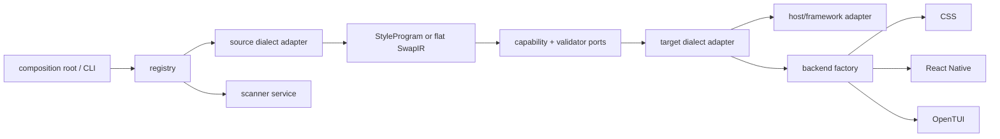

# Interface-first architecture and residual lowering plan

## Context

Pandwind already has versioned adapter, semantic-program, scanner, host, and
backend contracts, but several concrete implementations still live behind
large shared modules and bag-of-exports boundaries. The remaining migration
corpus also exposes three real semantic gaps: standalone styled subjects,
Aphrodite font-face arrays, and function-valued Solid/Vue styles.

The repository has no checked-in feature-plan template at the location
prescribed by the feature-plan skill. This plan therefore follows that
skill's required section structure directly.

## Goal

Make every extensible Pandwind domain interface-first and independently
adaptable, remove verified dead code with Knip, and lower the remaining
corpus residuals without silent semantic loss.

## What

- Keep migration orchestration dependent on source/target adapter interfaces,
  with nested dialect adapters where one ecosystem has multiple APIs.
- Make each concrete codemod adapter cohesive: detection, config, parsing,
  emission, capabilities, dependencies, and validation are owned by that
  adapter module; shared mechanics remain generic ports.
- Keep scanners language/document agnostic and route all consumers through the
  shared scanner service.
- Keep CSS, React Native, and OpenTUI behind one backend factory contract.
- Keep CLI modules as composition roots rather than semantic owners.
- Add Knip configuration, run it across every workspace, and delete only code
  proven unused or obsolete by the graph and tests.
- Lower standalone styled subjects with host wrappers, Aphrodite font-face
  arrays into rule-level font-face IR, and function-valued Solid/Vue styles
  through framework-specific prop/theme wrappers.

## Why

Pandwind is valuable as a pivot only if adding an adapter is local and if the
same semantic program can be consumed by multiple hosts, languages, and
backends. Residuals are useful only when they identify a genuine target gap;
these three remaining families are representable and should be converted.

## How

The flat `SwapIR` remains the fast path. Rich semantic migrations use the
versioned StyleProgram. A concrete adapter file may use generic parser,
renderer, or validator utilities, but it owns its dialect policy and does not
leak that policy into CLI or central orchestration.

## What this allows

- Add another Panda dialect, source language, framework host, backend, or
  external adapter by implementing and registering one contract.
- Test a fake adapter or backend against orchestration without changing core
  branches.
- Convert runtime styles while preserving prop/theme execution semantics in
  supported React, Solid, and Vue host forms.
- Detect and remove dead exports before release with a repeatable workspace
  check.

## What this does not allow

- It does not claim lossless conversion for an unrepresentable runtime or
  framework behavior.
- It does not expand the frozen runtime authoring API.
- It does not make the CLI a second adapter implementation.
- It does not delete generated fixtures or public entry points merely because
  a static graph cannot see their dynamic use; those cases require explicit
  entry/config evidence.

## UI & UX

No new runtime UI is required. CLI and inspector reports should continue to
show adapter identity, converted ranges, provenance, dependencies,
capabilities, validation, and residuals. A successfully lowered residual must
disappear from the residual report and gain a fixture proving its behavior.

## Data model

- `StyleAdapter` and `StyleAdapterRegistry` for source/target dialects.
- `SourceScannerService`, `SourceLanguageAdapter`, and `SourceDocument` for
  language-neutral scanning.
- `StyleBackendFactory` and `StyleBackendRegistry` for target backends.
- `HostComponentRewriter` and framework-specific wrapper ports.
- `StyleProgram` rule-level IR, including font-face rules and runtime
  metadata, with flat `SwapIR` preserved.
- `Knip` workspace configuration and a checked-in dead-code baseline only when
  an intentional dynamic entry cannot be represented statically.

## Implementation steps

- [x] Reconcile current architecture and document any missing port boundary.
- [x] Refactor adapter modules into cohesive implementations and remove
      central dialect policy from CLI/orchestration.
- [x] Refactor scanner and backend consumers to depend only on registries and
      interfaces; add fake-adapter contract tests.
- [x] Configure Knip for the monorepo, remove verified dead code/exports, and
      add a CI-facing script.
- [x] Implement standalone styled-subject host wrappers and fixtures.
- [x] Implement Aphrodite font-face-array parsing/lowering and fixtures.
- [x] Implement Solid/Vue function-valued prop/theme wrappers and fixtures.
- [x] Run typecheck, lint, format, package tests, corpus, release checks, and
      Knip; refresh plan/evidence.

## Open questions

- Standalone subjects without framework metadata remain explicit residuals;
  there is no safe host syntax to infer.
- Third-party adapters use the published plugin contract and can remain
  independently owned modules or packages; the registry boundary is the
  stable integration point.
- Knip findings are either removed or documented in `knip.json` only where
  framework/workspace/dynamic loading prevents static reachability analysis.

## Acceptance criteria

- [x] Concrete adapters expose one cohesive implementation boundary and no
      CLI branch contains ecosystem-specific parsing or emission policy.
- [x] Scanner and backend tests prove a second implementation can be
      registered without changing orchestration.
- [x] Knip runs from the root and has no unexplained production findings.
- [x] Standalone styled subjects are rewritten for supported hosts with no
      residual when semantics are representable.
- [x] Aphrodite font-face arrays produce rule-level `font-face` output and
      canonical CSS parity.
- [x] Solid/Vue function-valued styles preserve props/theme evaluation through
      explicit framework wrappers, or produce a precise residual only for an
      actually unsupported host form.
- [x] All repository validation and release preflight checks pass.

## Decisions log

- 2026-08-27 — Preserve the flat `SwapIR` fast path while making the semantic
  StyleProgram path the extensibility boundary.
- 2026-08-27 — Treat adapter files as cohesive policy owners and shared parser,
  renderer, and registry code as reusable infrastructure.
- 2026-08-27 — Keep the user-facing Pandwind runtime API frozen; this wave is
  compiler, codemod, backend, scanner, and maintenance work.
- 2026-08-27 — Close representable residuals in the pinned corpus with
  host-aware rewrites; retain residuals only when framework context is absent
  or the target semantics cannot be represented safely.
