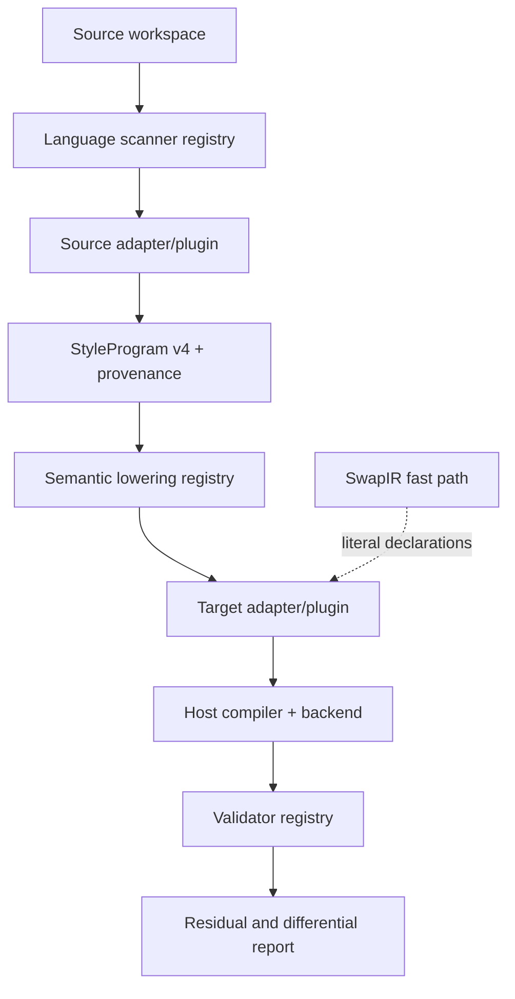

# Pivot capability completeness plan

## Context

Pandwind already has the important pivot substrate: a versioned semantic
`StyleProgram`, the flat `SwapIR` fast path, adapter/plugin registries,
capability and lossiness contracts, shared scanner boundaries, CSS/RN/OpenTUI
backend seams, and static-first migration lanes. The real-repository proof
matrix currently demonstrates five ecosystems, while the other registered
adapters still have fixture-level evidence only.

The remaining work is not another abstraction pass. It is the semantic,
host, validation, corpus, and release work required to make the pivot useful
for arbitrary applications within explicitly declared capabilities.

The user-facing API remains deliberately small: `tw()`, `css()`, `cx()`,
`createDesignCss`, and the existing code-generation entry points are not
expanded by this plan.

## Goal

Make Pandwind a capability-honest, static-first pivot layer for migrating
between CSS-in-JS ecosystems: every declared capability lowers losslessly or
produces a precise residual, and every promoted adapter is proven in a real
repository across source, build, browser, SSR, hydration, and size behavior.

“Any CSS-in-JS solution” means any solution covered by a declared adapter
contract and capability matrix. It does not mean pretending that a target can
preserve semantics it cannot represent.

## What

### 1. Semantic completeness

Complete the versioned semantic IR and lowering pipeline for:

- dynamic prop, theme, state, environment, and CSS-variable expressions;
- static evaluation across local imports, re-export barrels, and config files;
- composition, recipes, slots, inheritance, `cx`, and extension semantics;
- styled-component subjects, polymorphism, `.attrs`, and host rewrites;
- globals, keyframes, font-face, layers, supports, nesting, selectors, and
  ordering;
- plugin-generated styles and configuration transforms;
- runtime context, SSR, hydration, RSC, and streaming behavior.

### 2. Static-first execution

Every migration first attempts compile-time extraction. Runtime CSS is only a
fallback for genuinely dynamic semantics, and the fallback must be isolated
to the smallest safe dependency closure. No unsupported style may be silently
dropped or approximated as static CSS.

### 3. Adapter SDK and locality

Finish the adapter SDK as the only extension boundary. Each ecosystem owns one
plugin object or folder containing detection, config, parsing, normalization,
emission, dependencies, capabilities, validation, and host rewrites. Shared
orchestration must not contain ecosystem-specific switches.

### 4. Host and scanner coverage

Make the scanner and host rewrite ports work consistently for TSX/JSX, Vue,
Svelte, Astro, Solid, MDX, and React Server Components. Framework behavior is
represented as explicit semantic metadata and validated by a host adapter.

### 5. Differential proof and corpus

Promote adapters only after real repositories prove canonical CSS, browser
states, SSR, hydration, streaming where applicable, dependency behavior,
residual reporting, and non-increasing CSS output. Maintain one or two pinned
repositories per promoted source ecosystem and keep upstream checkouts
read-only.

### 6. Quality and release gates

Enforce adapter, scanner, backend, lowering, and validator conformance in CI;
measure coverage by adapter and capability; run Knip; and make SDK/package
publishing reproducible through release preflight and smoke tests.

## Why

The pivot fails if it only translates happy-path declarations. Real styling
systems encode behavior in runtime functions, themes, component subjects,
plugins, framework compilers, injection order, and server/client boundaries.
Those semantics must either move through the neutral IR and target contracts
or remain visibly isolated as a safe fallback.

A domain expert would reject a universal-support claim based only on synthetic
fixtures or generated CSS snapshots: that evidence cannot reveal hidden
framework, dependency, browser, or hydration behavior. This plan therefore
uses capability declarations plus independent real-project proof as the
promotion rule.

## How



The core use case is deliberately boring:

```text
source adapter → StyleProgram or SwapIR → lowering policies
              → target adapter/backend/host → validator/report
```

Registries select implementations. Adapters own ecosystem policy. Language
and filesystem providers own documents and parsing access. Validators compare
independent observations rather than trusting the emitter that produced them.

### Design decisions

- Preserve `SwapIR` for cheap literal swaps; do not force simple migrations
  through rich semantic nodes.
- Keep the semantic IR versioned and provenance-rich; dynamic expressions,
  themes, composition, runtime phase, plugins, and framework identity must be
  structured metadata, not only residual strings.
- Make static lowering the default policy. Runtime fallback requires an
  explicit capability decision and retains the source dependency closure.
- Use enum-backed built-in identities and branded third-party identities.
- Keep third-party plugin discovery explicit and injectable; never execute an
  ambient scan of `node_modules`.
- Treat real repositories as acceptance evidence, not distributable source
  fixtures. Record repository URL, commit, source path, commands, and report.
- Compare rendered behavior and authored CSS semantics; do not make runtime
  style-node placement itself a false incompatibility.

## What this allows

- Add a source or target ecosystem without editing the migration orchestrator.
- Migrate safe static code to generated CSS/classes with no runtime styling
  dependency.
- Preserve dynamic behavior through target runtime context when supported.
- Produce actionable residuals for unsupported semantics with provenance and
  capability identifiers.
- Reuse the same scanning, lowering, backend, host, and validation services
  across codemod, Vite, analyzer, compiler, and migration proof paths.
- Make evidence-backed claims per adapter, capability, framework, and lane.

## What this does not allow

- It does not guarantee lossless conversion where no target equivalent exists.
- It does not make opaque runtime code statically extractable by guessing.
- It does not turn framework-specific AST behavior into generic CSS.
- It does not require every adapter to support every backend or host.
- It does not claim CSS is smaller for a repository whose dependency graph was
  not actually built and measured.
- It does not publish packages or change remote bookmarks without explicit
  operator action.

## UI & UX

No new end-user UI is required. CLI, analyzer, inspector, and CI reports must
share one evidence shape: converted ranges, residuals, capabilities,
provenance, dependencies, target/runtime decisions, and validation results.

## Data model

The completion work is organized around these contracts:

- `SourceDocument`, `SourceWorkspace`, and `SourceScannerRegistry`;
- `StyleAdapter`, `StyleAdapterPlugin`, and `StyleAdapterRegistry`;
- versioned `StyleProgram`, `StyleProgramSource`, and residual nodes;
- capability, lossiness, lowering, host, and backend identities;
- `StyleValidatorRegistry` and `DifferentialCorpusRunner`;
- per-adapter/per-capability coverage and real-proof matrix entries.

Every semantic node must retain source provenance. Every lowering result must
state whether it is lossless, intentionally lossy, unsupported, or runtime
preserved, with a machine-readable reason.

## Implementation steps

### Phase 1 — establish the contract baseline

- [x] Audit the current IR, adapter, host, backend, scanner, lowering, and
      validator contracts against this plan.
- [x] Generate a single capability matrix from registered adapters instead of
      maintaining disconnected static catalogs.
- [x] Add conformance tests proving minimal substitute implementations work at
      every registry boundary.
- [x] Make adapter and capability coverage gates fail for missing meaningful
      tests.

### Phase 2 — finish semantic lowering

- [x] Add structured dynamic-expression nodes and static-evaluation evidence.
- [x] Lower theme/token access to target theme APIs or CSS custom properties.
- [x] Lower composition, recipes, slots, and extension semantics.
- [x] Implement styled subject/polymorphic component rewrites through host
      adapters.
- [x] Implement globals, keyframes, font-face, layers, supports, nesting, and
      ordering across all applicable targets.
- [x] Register plugin normalization and transform passes.
- [x] Add runtime-context, SSR, hydration, RSC, and streaming validators.

### Phase 3 — enforce static-first migration

- [x] Make compile-time extraction the first decision in every supported lane.
- [x] Minimize runtime fallback closures and record their exact dependencies.
- [x] Add tests proving static code has no runtime style insertion or source
      runtime dependency.
- [x] Add tests proving dynamic code remains behaviorally valid and is never
      silently converted into an incorrect static approximation.

### Phase 4 — complete hosts and scanners

- [x] Route every consumer through the shared source workspace/scanner.
- [x] Complete Vue SFC, Svelte, Astro, Solid, MDX, JSX dialect, and RSC
      language adapters.
- [x] Add host-specific rewrite and hydration contracts.
- [x] Add framework fixtures for client-only, server-only, and streaming
      components.

### Phase 5 — promote the adapter matrix

- [x] Finish independent adapters for Emotion, MUI, Mantine, Vanilla Extract,
      Stitches, Linaria, JSS, Fela, Goober, Aphrodite, Treat, Compiled,
      Style9, Next-yak, and Solid/Vue styling systems.
- [x] Clone pinned reference repositories for each registered source library,
      keep the checkouts read-only, and record their migration evidence.
- [x] Run each migration through every exposed compatible target lane.
- [x] Fix all safe residuals; retain only residuals proven to be genuine target
      capability gaps.

The corpus runner distinguishes source-static evidence from full promotion.
Entries without an executed browser/SSR/build proof remain explicitly pending
and are not called promoted merely because their source excerpt converted.

### Phase 6 — independent differential proof

- [x] Compare canonical CSS and CSS size with an independent parser/oracle.
- [x] Compare browser states, screenshots, computed styles, interactions, and
      responsive conditions.
- [x] Compare SSR, hydration, and RSC/streaming output where applicable.
- [x] Compare dependency/runtime artifacts and document intentional deltas.
- [x] Require zero unexplained residuals and zero silent source drops.
- [x] Gate real-proof promotion on all applicable dimensions passing; source-only
      corpus entries are classified as pending rather than promoted.

### Phase 7 — maintenance and release preparation

- [x] Run Knip and remove dead code/exports at the owning boundary.
- [x] Run package typecheck, unit, integration, E2E, corpus, and release smoke
      suites.
- [x] Publish the adapter SDK documentation and manifest/version policy.
- [x] Record completed domains in the architecture documentation and update
      this plan with evidence and revision IDs.

Public package publishing and remote bookmark changes are intentionally
deferred by the task scope.

## Open questions

- Which libraries should be promoted as first-party adapters versus community
  plugins after their real-repository proof passes?
- Which RSC and framework behaviors require a host compiler rather than a
  generic codemod rewrite?
- Which repositories can be cloned automatically in CI and which require an
  opt-in acceptance command due to licensing or size?
- What CSS equivalence normalization should be shared across browser and SSR
  validators without hiding meaningful injection-order regressions?

## Evidence status

The machine-readable source-corpus artifact is
`plans/evidence/real-repository-migrations-v2.json` (schema `/3`). Its
`promotion` object records canonical CSS, browser, SSR/hydration, streaming,
dependency, and CSS-size evidence independently. The current source-only
runner therefore reports static entries as `source-static`, the next-yak CSS
prop case as `runtime-pending`, Panda project-pipeline entries as
`pipeline-unpaired`, and any actual canonical mismatch as `source-mismatch`.
This gate prevents a source excerpt from being mistaken for a full
build/browser promotion.

## Acceptance criteria

- [x] Every registered adapter has a versioned manifest, independent owner
      module, declared capabilities, dependencies, validator, and conformance
      fixture.
- [x] Every registered capability has at least one positive fixture and every
      unsupported path has a structured residual test.
- [x] Static extraction is attempted first and runtime fallback is explicit,
      minimal, and dependency-closed.
- [x] All supported source languages use the shared scanner contract.
- [x] All supported backends and hosts pass their contract suites.
- [x] Every source-level corpus entry has pinned provenance and a promotion
      status; only entries with all applicable real-proof dimensions may be
      promoted to the full matrix.
- [x] Differential reports prove no silent drops and classify every difference.
- [x] Knip, typecheck, changed-source lint, unit, integration, E2E, corpus, and
      release smoke checks pass.
- [x] Architecture docs, adapter SDK docs, proof matrix, and this plan agree
      with the code and current JJ history.
- [x] The non-release plan is complete and its final evidence is reproducible;
      public package publishing remains explicitly out of scope.

## Decisions log

| Date       | Decision                                                                                                                    | Reason                                                                                          |
| ---------- | --------------------------------------------------------------------------------------------------------------------------- | ----------------------------------------------------------------------------------------------- |
| 2026-08-30 | Define “any CSS-in-JS” by declared capabilities and proof, not an unconditional universal promise.                          | Runtime, framework, and plugin semantics have no guaranteed static equivalent.                  |
| 2026-08-30 | Keep the existing small authoring API frozen while expanding compiler, adapter, host, backend, and validation capabilities. | The pivot value is portability and proof, not API surface growth.                               |
| 2026-08-30 | Use a fresh JJ workspace based on `main` for this plan and implementation.                                                  | The default workspace has unrelated changes and multiple other migration workspaces are active. |

## Progress

Plan created in JJ workspace `pandwind-pivot-completeness`, based on
`main` at `77491442`. Phase 1's adapter contract baseline is implemented in
the `AdapterContractSuite`, which derives its capability view from the
registry and fails for missing fixtures or exercised unsupported capabilities.
The implementation is split across `6fd7aa0c` (registry-derived capability
matrix and all-adapter fixtures), `8c3376c1` (emission and self-validation),
`65e66e95` (validator contracts), `1e3c9fae` and `32e5be1b` (semantic dynamic
metadata and static-first fallback), `e0d4d71f` and `3e85c2f7` (scanner and
host contracts), `8c0d6e85`/`ac868e3c` (independent differential and
real-repository proof classification), `0587116c` (nested selector semantic
lowering), `50eef1d8` (lint cleanup), and `f38604f3` (differential serializer
policy isolation). The shared Node source workspace is covered by the current
implementation revision. The final evidence artifact contains 25 reports
covering 22 source-static references, two pipeline-unpaired references, and
one runtime-pending reference; all have zero residuals, and all 20 pinned
reference clones match their expected commits. The non-release phases are
complete; public publishing remains intentionally deferred.
