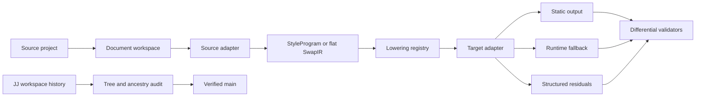
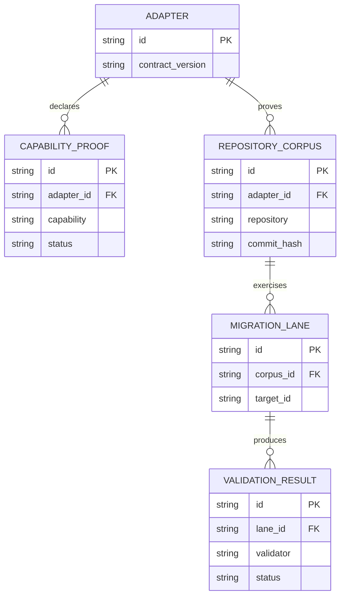

# Pivot completeness and history audit plan

## Context

Pandwind now has the central pivot architecture: versioned semantic IR with a
flat `SwapIR` fast path, registry-backed source and target adapters, shared
scanner and lowering contracts, typed capability/lossiness reports, official
configuration-loader ports, static-first migration, and an interactive
playground migration lab.

The remaining gap is proof and enforcement. The visible `main` history is
linear, but several earlier workspaces were consolidated through duplicate,
rebase, and merge/fix operations. Before further implementation work, we need
to verify that the final tree retained every relevant behavior, test, fixture,
documentation artifact, and proof record from those workspaces.

Related plans:

- `plans/025-css-in-js-pivot.md`
- `plans/027-css-in-js-completeness.md`
- `plans/031-css-in-js-pivot-completion-wave.md`
- `plans/032-css-in-js-pivot-finish.md`
- `plans/037-pivot-capability-completeness.md`
- `plans/038-pivot-proof-matrix.md`
- `plans/033-interface-first-architecture.md`

## Goal

Make Pandwind a fully proven, interface-first pivot layer for the explicitly
supported CSS-in-JS ecosystems: every declared capability converts or emits a
structured residual, every adapter is independently replaceable, and every
relevant historical workspace contribution is retained exactly once on
`main`.

“100% done” means 100% of the declared support contract is tested and
reproducible; it does not claim that arbitrary undiscovered semantics in every
future codebase can be converted without analysis.

## What

This plan covers:

1. A read-only JJ history audit of every prior workspace merge,
   consolidation, duplicate, rebase, and merge-fix operation.
2. Restoration of any relevant behavior, tests, docs, fixtures, or scripts
   proven to have been dropped, with one focused JJ revision per restoration.
3. Completion of the semantic, scanner, adapter, backend, and validator
   contracts required by the pivot architecture.
4. Production-grade real-repository migration and differential proof for every
   adapter and every claimed capability.
5. CI gates that prevent unsupported semantics, untested adapters, dead
   exports, or non-reproducible corpus claims from returning.

## Why

Adapter count and synthetic fixtures are not sufficient evidence for a pivot
library. The dangerous failures are silent semantic loss, config-dependent
behavior, framework host mismatches, CSS ordering changes, SSR/hydration
regressions, and history consolidation that accidentally removes a tested
implementation. This plan closes those risks with explicit contracts,
reproducible corpora, and tree-level history verification.

## How

### Conceptual model



### Operations / behavior

- Resolve source and target adapters through registries, never pair-specific
  migration branches.
- Load official project configuration when an ecosystem package is available;
  use deterministic fallback only when it is safe and report failures.
- Preserve the static-first order: compile-time extraction, target-native
  rewrite, minimal runtime fallback, then explicit residual.
- Carry theme, composition, runtime context, framework, plugin-transform, and
  provenance semantics in versioned IR and host contracts.
- Run the same scanner, lowering, validator, and capability contracts from
  codemod, Vite, analyzer, compiler, and playground composition roots.
- Audit every historical workspace contribution before removing or
  superseding it.

### Tech choices

| Choice | Decision | Rationale |
|--------|----------|-----------|
| Migration representation | Versioned `StyleProgram` plus flat `SwapIR` fast path | Rich semantics are available without making simple migrations expensive. |
| Extensibility | Versioned ports and explicit registries | A new ecosystem should require one adapter/plugin and conformance tests. |
| Config loading | Official ecosystem package through an injected loader | Presets, plugins, themes, shortcuts, and generated tokens are not safely recoverable from source text alone. |
| Dynamic styles | Static extraction first, smallest runtime fallback second | Runtime CSS is a compatibility escape hatch, not the default migration result. |
| History consolidation | Duplicate/rebase with explicit commit IDs and tree-equality gates | JJ workspace ownership and conflict resolution must not silently drop behavior. |
| External corpora | Download scripts pinned to repository commit hashes | Reference repositories remain reproducible without vendoring their source. |
| Validation | Contract, unit, integration, browser, SSR, hydration, and size matrices | CSS equivalence alone does not prove framework or runtime behavior. |

### Architecture

```text
Composition root
  ├─ AdapterRegistry
  │    └─ Source/target adapter plugins
  ├─ DocumentWorkspace + SourceScannerRegistry
  ├─ StyleProgram / SwapIR
  ├─ LoweringRegistry
  ├─ BackendRegistry
  └─ ValidatorRegistry

Adapter plugin owns:
  detection · official config · parse · normalize · emit · dependencies
  capabilities · lossiness · host rewrites · adapter validation · fixtures
```

### History-audit method

1. Record the current JJ operation-log anchor and workspace map.
2. Enumerate visible `main` ancestry, all visible heads, workspace heads, and
   all identifiable merge/consolidation/fix revisions.
3. For each source workspace, capture commit IDs, changed paths, tree hash,
   tests, docs, scripts, and generated-artifact policy.
4. Compare the source workspace tip with its intended `main` descendant using
   explicit commit IDs and full tree/path diffs, not only conflict markers.
5. Classify every difference as retained, intentionally superseded,
   duplicated, generated, or missing.
6. Restore only proven relevant missing content, oldest dependency first, and
   verify tree equality and tests after every restoration.
7. Confirm `main` contains all retained work, has no conflicts, and leaves only
   intentional empty workspace children.

## What this allows

- Adding a new source or target ecosystem without editing migration
  orchestration.
- Migrating between any registered source and target adapter in the playground
  using the same contracts as the CLI.
- Proving static output, runtime fallback, SSR, hydration, and browser parity
  independently by capability.
- Reproducing every real-project migration from a pinned repository reference.
- Detecting semantic gaps before code generation and presenting actionable
  residual reports instead of silently changing behavior.
- Safely consolidating future JJ workspaces without losing tested behavior.

## What this does not allow

- Claiming universal conversion for undocumented library plugins or custom
  framework transforms without a fixture and capability declaration.
- Treating a source-level or synthetic fixture as browser/SSR proof.
- Hiding unsupported behavior in opaque residual text or silently dropping it.
- Importing ecosystem-specific policy into shared orchestration or CLI files.
- Vendoring external repositories as application source.
- Making a public API addition without a separate design note and maintainer
  approval.

## UI & UX

### Desktop

The playground migration lab exposes registry-derived source and target
selectors, an editable source document, emitted output, capability pills,
validation status, dependency changes, and residual details. It must remain a
preview of the core migration use case rather than a second implementation.

### Mobile

Controls stack vertically. Source, target, run/reset, result status, and
residuals remain usable without requiring side-by-side panes.

### Common interactions

| Action | Result |
|--------|--------|
| Select source adapter | Loads its representative sample and reruns migration. |
| Select target adapter | Reruns the same route against the selected target contract. |
| Edit source | Updates output and validation without writing project files. |
| Inspect residual | Shows the exact semantic gap and suggested next action. |
| Run repository proof | Materializes the pinned corpus and executes build, browser, SSR, and size gates. |

## Data model



## Implementation steps

1. Create the JJ history inventory and operation-log anchor.
2. Audit every previous workspace merge and classify tree/content differences.
3. Restore any proven missing behavior in focused revisions and verify after
   each restoration.
4. Finish scanner unification and remove duplicate filesystem/parser policy.
5. Complete semantic lowering and host/framework rewrites for dynamic,
   themed, composed, plugin-generated, SSR, hydration, and RSC behavior.
6. Finish official config-loader integrations and their injected-loader tests.
7. Enforce one-plugin-per-ecosystem locality and stabilize the adapter SDK,
   backend, lowering, scanner, and validator contracts.
8. Add contract coverage gates per adapter and per capability.
9. Add pinned real repositories and run every migration lane through build,
   lint, typecheck, browser, SSR, hydration, and CSS-size validation.
10. Update architecture, migration, adapter, and proof documentation from the
    verified implementation; mark only demonstrated capabilities complete.
11. Run the complete repository quality suite and confirm a clean `main`
    ancestry with no unresolved conflicts or duplicate active workspaces.

## Open questions

1. Which ecosystems are promoted to the supported contract first, versus
   remaining experimental until their real-project matrices pass?
2. Which browser-only optional configuration features should be disabled from
   the playground surface rather than represented as project-aware residuals?
3. What minimum screenshot and CSS-size tolerance is acceptable for each
   framework when injection topology differs but rendered behavior matches?
4. Which generated proof artifacts belong in the repository and which must be
   recreated by scripts?

## Acceptance criteria

- [x] A JJ operation anchor and workspace inventory are recorded before any
      history mutation.
- [x] Every prior workspace merge/consolidation is classified with explicit
      commit IDs and tree/path evidence.
- [x] No relevant implementation, test, fixture, proof, documentation, or
      script was dropped; proven gaps are restored in focused revisions.
- [x] `main` contains the retained work exactly once and has no conflicted
      commits or unresolved workspace heads.
- [ ] Every registered adapter implements the versioned contract and passes
      generic conformance tests.
- [ ] Every declared capability has meaningful adapter, integration, browser,
      SSR, hydration, and size evidence where applicable.
- [ ] Unsupported semantics produce structured residuals and never disappear.
- [ ] Static extraction is attempted before runtime fallback in every claimed
      web migration lane.
- [ ] Pinned corpus scripts reproduce every promoted real-repository proof.
- [ ] Shared scanner, lowering, backend, validator, and official-loader ports
      are used by all relevant composition roots.
- [ ] Knip, formatting, typecheck, unit, integration, and end-to-end gates are
      green.
- [ ] Architecture and migration docs match the verified implementation.

## Decisions log

| Date | Decision | Rationale |
|------|----------|-----------|
| 2026-08-31 | Define completion as a declared, proven support contract rather than literal universal conversion | Arbitrary future plugins and hidden runtime semantics cannot be proven without project evidence. |
| 2026-08-31 | Audit JJ history before implementing further pivot work | Previous workspace consolidation can silently lose behavior even when the final tree has no conflict markers. |
| 2026-08-31 | Preserve both `StyleProgram` and flat `SwapIR` | Rich semantics and low-cost common migrations have different performance and complexity requirements. |
