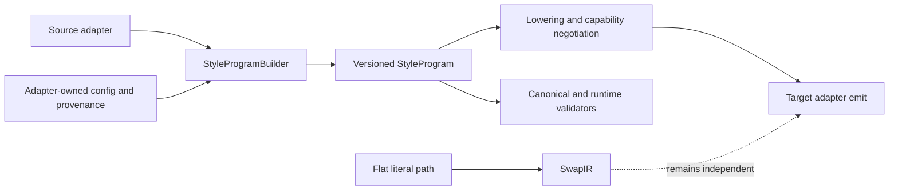
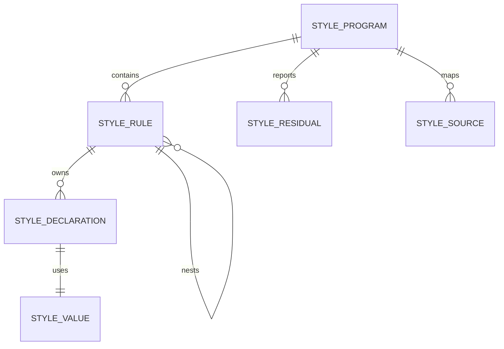

# Semantic style-program builder plan

## Context

Pandwind already has a versioned `StyleProgram` that is the semantic AST for
rich migrations, plus the flat `SwapIR` fast path for literal declaration
swaps. The program currently has to be assembled through low-level object
literals and `styleProgramFromRules`, which makes adapter implementations and
tests repeat normalization-sensitive details such as rule ordering, dynamic
value metadata, source maps, and root declaration projection.

The relevant architecture is:

- source adapters parse into `StyleProgram`;
- lowering negotiates a target representation and preserves residuals;
- target adapters own target syntax through their `emit` port;
- `SwapIR` remains the cheap compatibility projection and must not be forced
  through the richer builder when it is unnecessary.

This plan adds a construction façade over that existing IR. It does not create
a second AST or a new runtime styling API. It is related to
`plans/040-pivot-any-to-any-lowering.md` and
`plans/041-any-direction-adapter-completeness.md`.

## Goal

Make semantic program construction concise, typed, invariant-preserving, and
easy to use in real adapters and tests without expanding Pandwind's frozen
runtime API or coupling the semantic layer to any target library.

The useful form is a scoped builder/factory, not a mutable user-facing
`StyleNode` object and not one renderer function per target. A builder creates
the existing `StyleProgram`; registered target adapters still render it.

## Current status

The first vertical slice is implemented in focused JJ revisions. The builder
is exported from the codemod `swap` surface, Tailwind's class parser uses it
for one real semantic construction path, and the focused contract test feeds
builder output to the real Tailwind target emitter. The full target matrix and
slow CLI workflows remain intentionally untouched.

## What

Add an internal/SDK-level `StyleProgramBuilder` with a small rule-node API for
constructing and composing the existing versioned semantic IR. It must support
the rule-level semantics already represented by the IR:

- ordinary styles and global selectors;
- nested rules, selectors, media/container/supports conditions, and layers;
- keyframes, font-face, and property rules;
- literal, token, and dynamic values with static-evaluation metadata;
- themes, compositions, runtime context, plugin transforms, emission hints,
  source maps, and explicit residuals;
- deterministic authored ordering and the existing root declaration
  projection.

The builder is a construction tool. It is not a second representation and it
does not decide whether a target can represent a node. That remains the
lowering and adapter contract's responsibility.

## Why

The current object-literal construction is easy to get almost right while
omitting a source location, dynamic classification, child ordering, or a
program-level metadata field. It also makes a new adapter copy the shape of
existing adapters instead of depending on one coherent semantic construction
port.

A builder is useful now because adapters and conformance tests are actively
creating programs with the same rules and metadata. Centralizing construction
in one domain object gives those callers one place for invariants, while the
result remains the same `StyleProgram` consumed by every existing adapter and
validator.

## How

### Conceptual model



The builder owns construction and normalization only. It does not know
whether the eventual target is Tailwind, Chakra, StyleX, CSS, React Native, or
OpenTUI.

### Operations / behavior

The first vertical slice should provide:

1. `StyleProgramBuilder.create(options?)` and `StyleProgramBuilder.from(program)`.
2. `style`, `global`, `keyframes`, `fontFace`, `layer`, `supports`, and
   `property` rule methods.
3. A nested rule operation that accepts normalized child rule inputs with
   optional child orders, without exposing mutable internal arrays.
4. Typed value helpers for literal, token, and dynamic values, including an
   explicit fallback/lowering option for dynamic values.
5. Program metadata operations for themes, compositions, runtime context,
   plugin transforms, emission hints, source maps, and residuals.
6. `build()` returning the existing `StyleProgram` after applying the same
   normalization and ordering as the current factory.
7. A conformance/substitution test showing that a builder-created program is
   accepted by the existing canonical serializer, lowering bridge, and at
   least one registered target adapter.

The public shape should favor a scoped domain object such as
`StyleProgramBuilder.create().style(...).build()` over a bag of standalone
`createStyle*` exports. Target-specific functions such as
`styleProgramToTailwindCss` are deliberately not part of this change; target
adapters already provide that port.

### Tech choices

| Choice                                                     | Decision                                                                      | Rationale                                                                                          |
| ---------------------------------------------------------- | ----------------------------------------------------------------------------- | -------------------------------------------------------------------------------------------------- |
| Second AST hierarchy vs façade over `StyleProgram`         | Façade over the existing IR                                                   | Avoids duplicate schemas, visitors, provenance rules, and adapter contracts.                       |
| `new StyleNode().withStyle(...)` vs scoped program builder | `StyleProgramBuilder.create()` with scoped rule operations                    | A style migration is a program, and the builder can preserve program-level metadata and ordering.  |
| Mutable fluent builder vs immutable IR                     | Build-time mutable accumulator returning an immutable `StyleProgram` snapshot | Keeps adapter construction simple and cheap while preventing callers from mutating the emitted IR. |
| Target renderer helpers vs adapter `emit`                  | Existing target adapter `emit` port                                           | Keeps ecosystem policy local and makes one new adapter a registry addition.                        |
| Rich builder vs `SwapIR`                                   | Separate paths                                                                | Literal swaps should retain their existing low-cost behavior.                                      |
| Runtime public API                                         | No change                                                                     | The frozen `tw`/`css`/`cx`/design API is unaffected.                                               |

### Architecture

```text
StyleProgramBuilder (construction port + invariant owner)
  ├── StyleRuleBuilder inputs (style/global/at-rule nodes)
  ├── StyleValue construction and dynamic metadata
  ├── program metadata and provenance
  └── build() -> styleProgramFromRules(...) -> StyleProgram

StyleMigrationUseCase
  source adapter.parse() -> StyleProgramBuilder/StyleProgram
  -> lowering registry -> target adapter.emit()
  -> validator registry
```

The builder module owns only semantic construction. Source adapters own source
syntax and config interpretation. Target adapters own target syntax and host
rewrites. Validators continue to observe the neutral program rather than
depending on builder internals.

## What this allows

- Adapter implementations to construct rich programs without repeating IR
  object-literal boilerplate.
- Tests to express realistic rule trees and metadata while keeping inline
  snapshots focused on semantic output.
- One place to enforce ordering, dynamic normalization, source-map collection,
  and root declaration projection.
- Future builder users to remain compatible with every current target adapter
  because the output type is still `StyleProgram`.
- Safe program composition for adapter-owned themes, recipes, globals, and
  generated files, with explicit residuals when composition is not lossless.

## What this does not allow

- It does not make unsupported target semantics representable automatically.
- It does not turn arbitrary runtime expressions into static CSS.
- It does not add target-specific methods or a renderer switch to the core.
- It does not replace `SwapIR` for simple literal migrations.
- It does not expose a new runtime styling API to application authors.
- It does not hide residuals or make validators accept a lossy program silently.

## UI & UX

This is a developer-facing SDK and adapter authoring feature; there is no
product UI. The developer experience should read as a small semantic program:

```ts
const program = StyleProgramBuilder.create({ source })
	.style({ color: StyleProgramBuilder.token("color.foreground", { resolved: "#2563eb" }) })
	.global("body", { margin: 0 })
	.build();
```

The resulting object is the existing `StyleProgram`, rather than a custom
builder AST.

## Data model



No new persisted schema is introduced. The builder emits the existing
`STYLE_PROGRAM_SCHEMA`; any schema change must be separately versioned and
documented.

## Implementation steps

1. Define the builder contract and input types beside the semantic IR, reusing
   existing `StyleRuleInput`, `StyleProgramOptions`, and value metadata where
   possible.
2. Implement a scoped builder with deterministic order allocation, child rule
   support, metadata accumulation, and `build()` delegation to the existing
   normalization path.
3. Add focused inline-snapshot tests for static styles, tokens, dynamic values,
   nested conditions, rule-level nodes, metadata, residuals, source maps,
   `from(program)`, and malformed builder input.
4. Add a substitution/conformance test that sends builder output through the
   canonical CSS serializer, `SwapIR` projection where valid, and a real
   registered target adapter.
5. Adopt the builder in one adapter-owned construction path and one shared test
   fixture where it removes repeated semantic object literals; do not perform a
   broad mechanical rewrite until the vertical slice proves useful.
6. Document the builder as an adapter-authoring tool in the architecture docs,
   including when to use it and when to keep the `SwapIR` fast path.
7. Run focused typecheck, builder tests, adapter conformance tests, and lint;
   defer the full codemod matrix and generated `.tmp-codemod-e2e` workflows.

## Open questions

There are no blockers for the first vertical slice. The builder is exported
from the codemod `swap` subpath because adapter authors are its immediate
consumers; composition continues to accept finalized semantic values, and
nested rules use normalized rule inputs rather than introducing another node
builder type. A nested-builder convenience can be considered only if a real
adapter needs it.

## Acceptance criteria

- [x] The plan is implemented in focused JJ revisions with no changes to the
      frozen runtime styling API.
- [x] A builder-created program is byte/schema compatible with the existing
      `StyleProgram` consumers and keeps `STYLE_PROGRAM_SCHEMA` unchanged.
- [x] Rule-level semantics, conditions, ordering, values, provenance, metadata,
      and residuals are preserved in focused inline-snapshot tests.
- [x] At least one source adapter uses the builder, and a real target adapter
      consumes builder output, without ecosystem logic leaking into the
      semantic module.
- [x] Canonical CSS, valid flat `SwapIR` projection, and target validation remain
      correct for supported builder-created programs.
- [x] Invalid or unsupported builder inputs fail explicitly or produce typed
      residuals; nothing is silently omitted.
- [x] Architecture documentation explains the builder boundary and the reason
      target renderers remain adapter-owned.
- [x] Focused typecheck, tests, and lint pass; slow full-matrix workflows are
      not required for this development slice.

## Decisions log

| Date       | Decision                                                                               | Rationale                                                                                                                    |
| ---------- | -------------------------------------------------------------------------------------- | ---------------------------------------------------------------------------------------------------------------------------- |
| 2026-09-01 | Treat `StyleProgram` as the AST and add a construction façade over it                  | A second node hierarchy would duplicate the versioned semantic contract.                                                     |
| 2026-09-01 | Use a scoped build-time program builder rather than a runtime `StyleNode` API          | The current need is adapter/test construction, while the application runtime API is frozen.                                  |
| 2026-09-01 | Keep target emission in registered adapters                                            | Target ownership is the core hexagonal boundary; generic `styleNodeToX` functions would recreate a central switchboard.      |
| 2026-09-01 | Preserve `SwapIR` as an independent fast path                                          | Rich semantic construction must not tax simple literal migrations.                                                           |
| 2026-09-01 | Export the builder from `pandwind-codemod/swap` and adopt it first in Tailwind parsing | Adapter authors are the current consumers, and the real parser adoption proves the façade removes object-literal repetition. |
