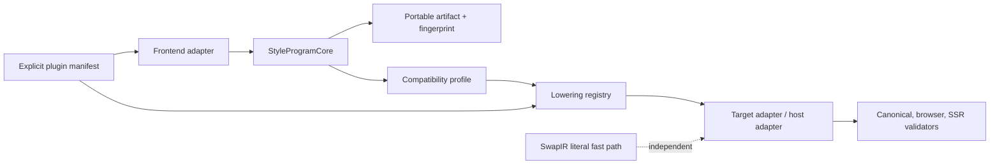

# LLVM-style semantic pivot core plan

## Context

The Turso article describes a useful architecture for a difficult
compatibility problem: one reliable, tested core accepts many language
frontends, compiles them to a common representation, and exposes explicit
compatibility boundaries instead of pretending every feature is identical.
The important analogy for Pandwind is the separation between a CSS-in-JS
frontend and the neutral semantic core, not a literal database bytecode VM.

Pandwind already has the essential pieces:

- versioned `StyleProgram` for rich rules, values, themes, composition,
  runtime context, plugins, provenance, and residuals;
- flat `SwapIR` as the cheap literal migration path;
- source and target adapter registries;
- capability-aware lowering and validator registries;
- shared scanner and project context boundaries.

The remaining architectural risk is that `StyleProgram` is still primarily a
TypeScript object passed directly between in-process modules. Its canonical
identity, compatibility profile, extension boundary, and deterministic
validation rules are distributed across callers. That makes caching,
out-of-process adapters, reproducible reports, and third-party contributions
harder than they need to be.

## Goal

Make `StyleProgram` a small, deterministic, cacheable compiler core for all
registered CSS-in-JS frontends and targets, while preserving the frozen
Pandwind author API and the flat `SwapIR` fast path.

The result should make this pipeline explicit:

```text
source frontend adapter
  -> project/document context
  -> normalized StyleProgram core
  -> compatibility profile + lowering plan
  -> target backend/host adapter
  -> canonical/browser/SSR validators
```

This is complete when a new source or target adapter can depend only on the
core contracts, when the same program has the same canonical identity on
every machine, and when unsupported semantics are reported as explicit
residuals rather than being guessed away.

## Current status

Complete. The builder, shared migration runner, and differential proof runner
pass frontend output through `StyleProgramCore`, which provides deterministic
structural serialization, a stable fingerprint, schema/rule validation, and a
versioned portable artifact envelope. Plugin manifests declare and negotiate
the core compatibility range, and registration rejects capability drift. The
runner boundary is substitution-tested with a source adapter that returns
stale metadata and a target adapter that only accepts the normalized core
shape. Differential results record the core version and normalized program
fingerprint. The `SwapIR` path and frozen runtime API are unchanged.

## What

### 1. Make the semantic core explicit

Add a scoped `StyleProgramCore` domain object over the existing IR. It owns:

- normalization and deterministic rule ordering;
- structural validation of required fields and value metadata;
- canonical serialization for cache keys and proof artifacts;
- a deterministic non-cryptographic fingerprint;
- conversion to and from a versioned portable artifact.

It must not become a second AST, renderer, adapter registry, or runtime
styling API. `StyleProgram` remains the semantic representation and
`SwapIR` remains the independent fast path.

### 2. Define compatibility profiles

Use the existing capability and lossiness contracts to describe what a
frontend/target pair promises:

- core CSS semantics: declarations, selectors, conditions, nesting, ordering;
- design semantics: tokens, themes, variants, composition, recipes;
- runtime semantics: interpolation, function values, host context;
- host semantics: framework bindings, styled subjects, SSR/hydration/RSC;
- extension semantics: plugin transforms and custom generated output.

Profiles are evidence-backed declarations, not permissions to silently fall
back. A profile that does not cover a semantic must select a static lowering,
validated runtime carrier, or structured residual.

### 3. Establish an extension ABI

Treat adapter and lowering plugins as explicit versioned extensions:

- plugin manifests declare core schema range, adapter ids, dependencies,
  capabilities, and validators;
- transforms receive immutable core programs and return a new program plus
  provenance/residual information;
- discovery stays explicit and injectable;
- plugins cannot mutate global registries or hide unsupported output.

This gives third-party adapters an out-of-tree contribution boundary without
making the central runner import ecosystem code.

### 4. Make reliability a product feature

Add reusable core conformance checks for:

- normalization idempotence;
- canonical serialization determinism;
- fingerprint stability;
- source-map and residual preservation;
- adapter substitution;
- lowering/emit/reparse differential agreement;
- fuzzed malformed and edge programs.

The existing adapter, browser, SSR, hydration, streaming, and size suites
remain the target-level oracle. The new core suite catches corruption before
those expensive validators run.

## Why

The article’s strongest lesson is that compatibility becomes practical when
many frontends share one reliable internal language. Pandwind already has
that language; formalizing its identity and extension boundary prevents every
adapter from reimplementing normalization, caching, and proof logic.

The second lesson is to define “compatible enough” honestly. A target does
not need to reproduce undocumented source internals, but it must declare the
supported semantic profile and preserve every unsupported construct visibly.

The third lesson is reliability engineering: deterministic tests, fuzzing,
oracle comparisons, and close architectural review are part of the core, not
polish after the adapters exist.

## How



The core should use stable structural serialization rather than CSS text as
its identity: equivalent CSS can have different target spellings, while
source metadata and residuals still matter to migration tooling. The
fingerprint is a cache/proof key, not a security hash.

Portable artifacts must contain the schema version, normalized program,
fingerprint, and core version. Loading an unsupported schema or mismatched
fingerprint fails explicitly with a configuration/provenance residual; it
must never be silently coerced.

## What this allows

- Shared parse/lower/emit tooling across codemod, Vite, analyzer, playground,
  and future out-of-process adapters.
- Deterministic cache keys for repeated migrations and browser/compiler work.
- Reproducible proof artifacts that can be compared across machines and CI.
- Third-party adapters that implement one documented extension contract.
- Capability reports that describe an evidence-backed compatibility profile.
- Fast rejection of malformed programs before target-specific work begins.

## What this does not allow

- It does not make every CSS-in-JS semantic representable by every target.
- It does not add a general-purpose bytecode interpreter or new styling API.
- It does not replace target-owned lowering, host rewrites, or validators.
- It does not force `SwapIR` callers through the richer program path.
- It does not allow plugins to mutate shared state or suppress residuals.
- It does not turn a fingerprint into a cryptographic integrity guarantee.

## UI & UX

There is no end-user UI change. Developer-facing reports may show the core
schema, fingerprint, compatibility profile, and residual categories so a
migration can be reproduced without inspecting internal object dumps.

## Data model

```ts
interface StyleProgramArtifact {
	schema: "pandwind.style-program-artifact/1";
	coreVersion: string;
	fingerprint: string;
	program: StyleProgram;
}
```

The artifact wraps the existing versioned `StyleProgram`; it does not alter
`STYLE_PROGRAM_SCHEMA`. Program fields remain immutable at the adapter
boundary. A later schema change requires an explicit artifact migration.

## Implementation steps

1. Add `StyleProgramCore` and stable structural canonicalization without
   changing the existing IR schema or runtime API.
2. Add artifact encode/decode and fingerprint verification with malformed and
   mismatched-input tests.
3. Route the builder and one real source adapter through the core, preserving
   `SwapIR` for flat literal cases.
4. Add core conformance tests for idempotence, determinism, provenance,
   residuals, and adapter substitution, including generated edge programs.
5. Define compatibility-profile types from the existing capability registry
   and expose them through adapter-owned contracts.
6. Add explicit plugin-manifest validation and core-version negotiation to the
   existing discovery registry.
7. Reuse core artifacts in differential reports, playground runs, and the
   migration cache only where measurements show a real benefit.
8. Document the core/extension boundary and update implementation status;
   keep the full codemod matrix and generated `.tmp-codemod-e2e` workflows
   deferred unless specifically requested.

## Open questions

- Whether portable artifacts should be written by default or only by proof,
  cache, and out-of-process tooling.
- Whether core version should be a package version or an independently
  bumped compatibility line.
- Which compatibility profiles should be required for promotion to the
  installed browser/SSR corpus.

## Acceptance criteria

- [x] `StyleProgramCore` is the single owner of normalization, validation,
      canonical serialization, and fingerprinting.
- [x] Normalizing a program twice is structurally identical to normalizing it
      once, across rule order, nested rules, metadata, and source maps.
- [x] Identical programs have identical fingerprints across repeated runs;
      meaningful semantic or provenance changes are observable.
- [x] Artifact encode/decode verifies schema and fingerprint and reports
      malformed input explicitly.
- [x] The shared migration runner and builder use the core without changing
      target-owned emission or the `SwapIR` fast path.
- [x] Core conformance tests include happy, malformed, edge, residual, and
      substitution cases.
- [x] Plugin manifests negotiate core versions and capabilities without
      central ecosystem branches.
- [x] Differential evidence records the core fingerprint used for a proof.
- [x] Documentation states the actual compatibility boundary and preserves
      the article’s “reliable core, many frontends” architecture.

## Decisions log

| Date       | Decision                                                                  | Rationale                                                                                                                            |
| ---------- | ------------------------------------------------------------------------- | ------------------------------------------------------------------------------------------------------------------------------------ |
| 2026-09-01 | Treat `StyleProgram` as Pandwind’s compiler core, not a new bytecode VM   | The existing IR already carries the required styling semantics; a second VM would duplicate policy and increase bundle/tooling cost. |
| 2026-09-01 | Add a scoped core façade and portable artifact around the existing schema | Deterministic identity, caching, and out-of-process proof need one owner without changing target adapters or the frozen author API.  |
| 2026-09-01 | Keep compatibility profile declarations evidence-backed and residual-safe | “Compatible enough” is useful only when unsupported semantics remain visible and actionable.                                         |
