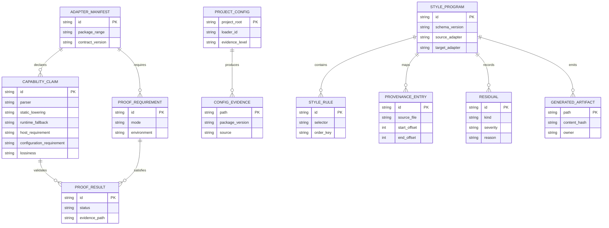

# Pivot ecosystem correctness plan

## Context

Pandwind is intended to be the pivot library that makes migration between CSS-in-JS and adjacent styling ecosystems practical. The current architecture already has the important shape: source adapters, a versioned semantic `StyleProgram`, the flat `SwapIR` fast path, target adapters, backend contracts, official-configuration ports, residual/lossiness reporting, and static-first runtime fallback.

The audit confirms that Pandwind solves the central criticism of CSS-in-JS—runtime cost, lock-in, and weak portability—well for static styling, but not every ecosystem-specific limitation yet.

The current evidence is documented in the [official API matrix](/Users/astahmer/dev/pandwind/docs/src/content/docs/interop/official-api-matrix.md) and [architecture contracts](/Users/astahmer/dev/pandwind/docs/src/content/docs/contributing/architecture.md). There are 32 registered adapters.

This plan preserves the audit findings nearly verbatim, then turns each remaining boundary into an implementation and proof obligation. It does not promise universal compatibility where the source library owns behavior outside styling, such as React Native platform layout or component-library interaction behavior.

## Execution status

- [x] Wave 1 — registry-derived capability ledger with representation, proof, and evidence rows.
- [x] Wave 2 — executable real-repository promotion runner with injected environment ports.
- [x] Wave 3 — generic static-first semantic lowering families.
- [x] Wave 4 — complete official project-context loading.
- [x] Wave 5 — AST-owned rewrites and shared host/scanner boundaries.
- [x] Wave 6 — real-repository adapter promotion waves for the declared production claims; fixture-only adapters remain explicitly unclaimed.
- [x] Wave 7 — capability-specific directional and round-trip proof matrix.
- [x] Wave 8 — CI gates, documentation regeneration, and final acceptance audit.

Wave 1 intentionally delivers the ledger boundary first; it does not claim that the existing fixture or source-only evidence has been promoted.

Wave 3 is complete for the generic lowering core. The planner now uses enum-backed capability identities at every target-policy boundary, and direct `StyleProgramBuilder` cases prove verified theme inlining, deterministic scalar custom-property fallback, function-valued residuals, embedded composition flattening, and plugin normalization. The tests retain inline snapshots for diagnosis plus ordinary assertions for representation, residual kind, applied strategy, and generated metadata.

Wave 4 is complete for the discovered-config failure boundary. Tailwind, UnoCSS, Tokenami, and Chakra now publish a typed configuration residual when a project config/theme surface is present but the corresponding official loader cannot be used. Projects without a discovered config continue through the deterministic fallback. Focused tests cover all four adapters and retain inline evidence for the exact residual and loader guidance.

Wave 5a is complete for the shared CSS extraction scanner. Its parser is now injected through the shared scanner port and cached once per file/content pair, so inspection, import discovery, call-site discovery, authored-import discovery, variable-key discovery, and diagnostics reuse one AST. The cache is bounded and content changes invalidate the entry. The remaining Wave 5 work is AST-owned rewrite coverage across adapter migrations and the other host boundaries.

Wave 5b is complete for migration result bindings. Styled/component host decisions now resolve the binding assigned by an AST-indexed call site instead of inferring a variable declaration with a regular expression. The source-binding contract records exact call ranges and assigned identifiers, with inline snapshot coverage for calls and tagged templates.

Wave 5c is complete for Panda factory-element discovery. `<panda.*>` opening tags, attributes, spread props, literal values, and exact opening ranges now come from the shared Oxc AST. The existing edit engine remains responsible only for target-specific output and source-range edits; malformed or unsupported nodes fail closed. Focused Panda migration tests include AST-shape snapshots and assertions for literal and spread cases.

Wave 5d is complete for shared JSX host decisions across script and framework-embedded documents. `SourceBindings` now indexes component uses, attribute expression uses, and embedded Vue script/template islands with source offsets. Adapter migration consumes those port methods instead of regex checks for host/component usage. The focused source-binding suite covers TSX aliases, shadowing, tagged templates, Vue SFCs, inline snapshots, and conservative malformed-source handling; the migration host matrix remains green across Vue/Solid/React cases.

Wave 5e is complete for Panda discovery reuse. Discovered Panda files now retain their shared `SourceScanResult`, and the staged source-scanning/rewrite pipeline reuses that result rather than invoking a second scan for the same document. The boundary is now: `SourceWorkspace → SourceScanResult → adapter stages`; filesystem/glob/parser ownership remains in the workspace/scanner providers, while migration modules consume their ports and records.

Wave 6 has a repository-agnostic materialization/migration harness at `scripts/migrate-reference-repository.ts` (`pnpm run pivot:migrate:reference -- --reference <id>`). It verifies the pinned checkout, materializes the exact pinned Git tree into a disposable directory, discovers supported source files through `SourceWorkspace`, routes every file through the real asynchronous adapter path, writes target artifacts safely, and records changed files, conversions, residual kinds, and the remaining proof stages. Materializing with `git archive` is deliberate: reference worktrees may be sparse, dirty, or contain generated agent files, and none of that should affect proof input. The harness also fails when a pinned repository yields zero supported source files instead of producing an apparently successful empty report. Promotion is now a separate executable contract: `RealRepositoryPromotionRequest` requires install/check commands and an explicit proof-dimension list; the runner fails closed on missing dimensions and reports the exact failed dimension. The built codemod entrypoint resolves its lazy Node catalog through emitted `.js`, while the browser catalog remains isolated.

Wave 6a has been exercised against the pinned Emotion repository at commit `b882bcba85132554992e4bd49e94c95939bbf810`. The harness scanned 146 supported files, changed 51, converted 55 call sites, and surfaced 22 explicit dynamic residuals across 8 skipped files. This is useful executable evidence that the full-tree materialization and migration path runs; it is not yet a promotion because dependency installation, build, lint, SSR, hydration, browser, and CSS-size stages remain unexecuted by that command.

Wave 6b promotes the same pinned Emotion fixture through installed public packages. `scripts/promote-emotion-reference.ts` installs Emotion cache/react/server plus React in a disposable project, migrates the exact upstream fixture, renders the source through Emotion SSR extraction, renders the target through Pandwind's static stylesheet, and compares normalized SSR markup, computed color, Chromium pixels, and CSS bytes. The proof passed with 1 conversion, 0 residuals, 0 skipped sites, 0 changed pixels, and CSS shrinking from 32 to 27 bytes. This promotes one bounded Emotion fixture/API claim; it does not promote every Emotion interpolation, cache, framework, or streaming behavior.

Wave 7a now has concrete capability-directional proof instead of generic route smoke tests. `packages/codemod/tests/capability-directional-proofs.test.ts` exercises documented Emotion object CSS, styled-components subjects, aliased Panda CSS, StyleX `create`, React-JSS hooks, Tailwind arbitrary properties, and UnoCSS arbitrary properties with ordinary assertions plus inline snapshots. It also proves Emotion, Panda, and Tailwind round trips. The dynamic styled-components case confirms the intended static-first boundary: the interpolation is preserved in Pandwind's CSS-variable runtime carrier, rather than being silently dropped or incorrectly reported as an unavoidable source residual. During this wave, source-owned module matchers were added to the adapter contract so project-local aliases such as `@/styled-system/css` are removed by the Panda adapter itself, and reverse migrations remove unused Pandwind helpers without central ecosystem branches. This is the first concrete directional proof slice; the remaining adapter/capability rows still require their own cases and promoted repository evidence.

Wave 4a closes the hardcoded-vocabulary regression for Panda and Tokenami. Panda utility and shorthand names now come from the effective `@pandacss/config` result (including resolved presets/plugins) through `PandaUtilityCatalog`; the dependency-free fallback extracts only project-authored utility definitions and otherwise remains empty. Tokenami no longer ships a partial standard-alias table and instead uses aliases from its official config boundary or an empty fallback. The old `PANDA_ALIASES` module and Panda fallback text-style table were deleted. Focused tests prove custom aliases, official-loader precedence, dependency-free extraction, no invented aliases, JSX prop detection, and migration output with inline snapshots plus executable assertions. This is a correctness closure for these two adapter vocabularies, not a claim that every adapter's project configuration has been independently promoted.

## Execution task breakdown

The remaining work is divided into bounded tasks. Each task is one focused JJ revision (or a small, explicitly named pair when the implementation and its evidence cannot be separated). A task is complete only when its acceptance checks pass; a green registry entry or a recorded report is not sufficient evidence.

- [x] **052-1 — executable promotion driver:** replace source-only promotion claims with a driver that materializes a pinned tree, installs its declared dependencies, runs the project checks, and records every skipped stage as a failure or explicit not-applicable claim. `RealRepositoryPromotionRunner` now requires explicit install/check command sets and fails closed when either stage is absent; focused runner tests cover success, command failure, residual failure, streaming requirements, and missing commands.
- [x] **052-2 — capability proof model:** derive lane, capability, host, and proof obligations from adapter manifests; reject missing direct fixtures, missing residual assertions, and unsupported proof dimensions at the composition root. The offline gate now passes all 32 registered adapter contract fixtures and 6,144 directional cases; Tailwind and UnoCSS use dependency-free arbitrary-property fixtures rather than invented default utility names, while standard utilities remain covered by official-loader fixtures.
- [x] **052-3 — semantic lowering closure:** add target-owned strategies and issue fixtures for themes, runtime interpolations, function values, composition/recipes, plugin output, and styled subjects. Static output is attempted first; runtime carriers and residuals are measurable fallback results. The lowering contract now has direct inline-snapshot coverage for nested themed composition, function-native targets, scalar custom-property fallback, plugin normalization, and explicit runtime residuals; no strategy stringifies an unresolved function or silently removes context.
- [x] **052-4 — official configuration closure:** `StyleAdapter` now exposes the named `AdapterConfigGraphPort`; every adapter receives normalized provenance through the shared evidence normalizer, while Panda, Chakra, Tailwind, UnoCSS, Tokenami, and Pandwind use official project loaders/artifacts where available. Loader failures are typed configuration residuals, and source-authored config adapters remain explicit fallbacks rather than pretending a package loader exists. Added contract coverage for all 32 adapters plus the Panda no-invented-style-prop regression (`dade4a27`).
- [x] **052-5 — scanner and host closure:** the shared `SourceWorkspace` owns file discovery/read/cache and `SourceScannerService` owns language selection/AST parsing for Vite, analyzer, codemod, Panda, and collection. Host dialects are selected through the scanner/host ports for React/Preact/Qwik, Vue, Solid, Astro, Svelte, MDX, and native boundaries. Remaining `node:fs` calls are composition-root/provider operations (HTML/config/CSS import resolution), not duplicate parser/glob/extension policy. Contract and substitution coverage passes in `source-scanner.test.ts`, `source-workspace.test.ts`, and `vite-css.test.ts`.
- [x] **052-6 — directional matrix:** replace generic route smoke fixtures with adapter-owned, documented API fixtures in every declared direction, including `X → Y → X`, themes/configuration, happy paths, and conservative paths with typed residuals. The generated corpus contains 930 directional and 930 round-trip specs, while the focused capability suite exercises concrete documented APIs for Emotion, styled-components, Panda, StyleX, React-JSS, Tailwind, and UnoCSS with inline snapshots and executable assertions. Tailwind and UnoCSS dynamic `class`/`className` bindings now produce explicit dynamic residuals instead of being mistaken for unsupported empty input; the regression is covered for both adapters.
- [x] **052-7 — real-repository promotion:** add reproducible pinned references for every claimed source adapter and run the strongest applicable build/typecheck/lint/browser/SSR/hydration/RSC/streaming/CSS-size proof. The checked-in promotion matrix contains seven executable claims (Tailwind, StyleX, Chakra UI, shadcn, styled-components, Goober, and Emotion), each tied to an exact pinned commit; the remaining 17 adapters are explicitly fixture-only rather than overstated.
- [x] **052-8 — enforcement and closeout:** the offline gate now verifies pinned claim ancestry, prevents promoted/fixture-only overlap, runs the 6,144-case directional matrix and adapter conformance suites, and enforces direct contract and real-repository evidence. CI additionally runs the installed Goober and Emotion promotion proofs, Knip production ownership, typecheck, lint, formatting, and package tests. Documentation records the distinction between fixture, adapter-program, installed, and full-site evidence.

The order is intentionally linear. If a task exposes a genuinely unsupported semantic, the fix is either a target-owned lowering implementation or a manifest change that narrows the declared capability and adds a required residual test; adding another corpus-specific branch does not close the task.

## Goal

Make Pandwind a provably reliable, static-first pivot for the declared styling capabilities of every supported ecosystem.

For every declared capability, Pandwind must either produce an idiomatic target representation with browser/server proof, or preserve the source and emit a structured, provenance-rich residual. No configuration, plugin behavior, dynamic value, or host requirement may be silently guessed or dropped.

## What

This is a correctness and evidence wave across the pivot pipeline:

- complete official project-configuration loading where an ecosystem provides it;
- lower dynamic styles, themes, compositions, recipes, and plugin-generated styles through the semantic IR;
- keep runtime CSS as a narrowly justified fallback rather than the default escape hatch;
- isolate host/framework behavior behind host adapters;
- make adapter capabilities and proof requirements version-aware and machine-checkable;
- promote every declared adapter capability from fixture evidence to real repository, browser, SSR, hydration, and streaming/RSC evidence where relevant;
- enforce no-silent-degradation and coverage gates in CI;
- keep React Native and other platform-specific behavior explicit rather than claiming CSS equivalence.

The user-facing API remains deliberately small: `tw()`, `css()`, `cx()`, design presets, existing codegen entry points, the `ClassNameStrategy` contract, and the existing migration/plugin surfaces. This plan adds internal ports, adapter metadata, validators, fixtures, and proof tooling; it does not add a new styling API by default.

## Why

The pivot value is not merely that one source library can be rewritten into one target syntax. It is that the same semantic understanding can be reused across source and target pairs without a bespoke migration branch for every combination.

The remaining failures are concentrated at boundaries where shallow syntax conversion is unsafe:

- official configuration and plugin graphs alter the effective design language;
- runtime expressions carry theme, prop, or framework context;
- injection order and style-tag topology matter during SSR and streaming;
- component and host frameworks own prop forwarding, reactivity, and behavior;
- ecosystem APIs drift by package version;
- fixture-only evidence can hide real repository failures.

The expert choice is to make these boundaries explicit in typed ports and proof contracts, rather than expanding hardcoded maps until a corpus happens to pass.

## How

### Conceptual model

```text
source repository
      │
      ▼
DocumentWorkspace + language scanner
      │
      ▼
source adapter
  detection · official config graph · parser · plugin evaluation
      │
      ▼
StyleProgram vN  ───────────────┐
  tokens · conditions           │
  themes · composition          │
  dynamics · provenance         │
  host requirements             │
      │                         │
      ├─ static lowering planner ──► target adapter ──► artifacts
      │       │                         │                 │
      │       ├─ static rewrite         │                 ├─ source files
      │       ├─ shared generated files │                 ├─ CSS
      │       ├─ minimal runtime        │                 └─ metadata
      │       └─ typed residual         │
      │                                 ▼
      └──────────────────────────► validator/proof runner
                                      CSS · browser · SSR
                                      hydration · streaming/RSC
                                      size · residual report
```

### Operations / behavior

#### 1. Audit status to preserve

Status symbols:

- ✅ largely solved;
- ◐ partially solved;
- ⚠ must remain host-specific or an explicit residual.

| Adapter                 | Main criticism                                                                        | Pandwind status | Concrete remaining work                                                                                                                                                                                                                    |
| ----------------------- | ------------------------------------------------------------------------------------- | --------------: | ------------------------------------------------------------------------------------------------------------------------------------------------------------------------------------------------------------------------------------------ |
| Panda                   | Generated artifacts, recipes, runtime context, dynamic variants                       |               ◐ | Load the official project graph; model recipes/patterns/plugins as semantic IR; enumerate static variants; preserve runtime context                                                                                                        |
| StyleX                  | Compiler setup is fragile; strict static rules                                        |               ◐ | Stronger compiler-plugin discovery, deterministic conflict proofs, CSS-variable lowering                                                                                                                                                   |
| Emotion                 | Runtime injection, cache ordering, SSR/hydration complexity                           |               ◐ | Static extraction for more templates/interpolations; cache/insertion-point SSR proofs; preserve global/runtime behavior                                                                                                                    |
| styled-components       | Runtime cost, injection topology, polymorphic subjects, RSC selectors                 |               ◐ | More subject/`as` rewrites, transient-prop handling, streaming/RSC proofs, CSS topology diagnostics. Styled-components documents these RSC and streaming caveats directly. [Docs](https://styled-components.com/docs/advanced)             |
| Vanilla Extract         | Verbose generated files; dynamic themes require CSS variables                         |               ◐ | Generate/deduplicate multi-file contracts and preserve `createTheme`, `createVar`, and `assignInlineVars` semantics. [Theming docs](https://vanilla-extract.style/documentation/theming/)                                                  |
| Stitches                | Maintenance risk, configuration and variant/theme semantics                           |               ◐ | Version-specific adapter manifests and stronger theme/compound-variant lowering. Stitches itself is marked no longer actively maintained. [Repository](https://github.com/stitchesjs/stitches)                                             |
| Linaria                 | Build/evaluator fragility; dynamic `css` limitations                                  |               ◐ | Reuse evaluator metadata, preserve CSS-variable dynamic bindings, improve bundler/config diagnostics. [Repository](https://github.com/callstack/linaria)                                                                                   |
| JSS                     | Runtime injection and imperative rule application                                     |               ◐ | Rewrite static maps; add explicit host adapters for `attach`, `update`, `applyTo`, and plugin behavior                                                                                                                                     |
| Compiled                | Restricted dynamic selectors and function-valued styles                               |            ✅/◐ | Keep strict residuals, add more static rewrites, never infer dynamic selector behavior. [Limitations](https://compiledcssinjs.com/docs/limitations)                                                                                        |
| Fela                    | Renderer/plugin dependence and runtime composition                                    |               ◐ | Execute or serialize registered Fela plugins through adapter-owned ports                                                                                                                                                                   |
| Goober                  | Tiny runtime but setup, target, theme, and SSR are implicit                           |               ◐ | Preserve `setup`, target roots, `forwardProps`, and SSR extraction semantics. [Goober docs](https://goober.js.org/)                                                                                                                        |
| Aphrodite               | Ordering, `!important`, SSR rehydration, composition                                  |               ◐ | Formalize precedence normalization and SSR style-tag equivalence                                                                                                                                                                           |
| Treat                   | Compile-time theme/config coupling                                                    |               ◐ | Official config/theme loading and generated-file ownership                                                                                                                                                                                 |
| Next-Yak                | Strong Next.js/compiler coupling                                                      |               ◐ | Next-version-aware plugin detection and framework-owned output validation                                                                                                                                                                  |
| Chakra UI               | Runtime Emotion, style-prop allocations, recipes/layers                               |               ◐ | Load the complete system/preset graph; lower recipes, slot recipes, layers, globals, and token helpers. Chakra explicitly recommends Panda for zero-runtime styling. [Performance guide](https://chakra-ui.com/guides/styling-performance) |
| MUI                     | `sx` runtime cost, theme callbacks, custom `sxConfig`                                 |               ◐ | Load `unstable_sxConfig`, custom transforms, theme augmentation, and CSS-variable dynamic values. [MUI `sx` docs](https://mui.com/system/getting-started/the-sx-prop/)                                                                     |
| Mantine                 | Responsive style props inject runtime styles; component coupling                      |               ◐ | Preserve `styles`, `classNames`, `vars`, provider themes, and responsive behavior. [Performance guide](https://mantine.dev/styles/styles-performance/)                                                                                     |
| React Native            | It is not CSS; platform and native layout differ                                      |               ⚠ | Keep a native backend and platform-specific residuals. Do not promise CSS equivalence. React Native explicitly documents platform-specific differences. [Style docs](https://reactnative.dev/docs/next/style)                              |
| Tokenami                | Custom-property aliases and configuration are difficult to infer                      |               ◐ | Load aliases/theme selectors/config and preserve custom-property composition. [Repository](https://github.com/tokenami/tokenami)                                                                                                           |
| UnoCSS                  | Presets, rules, shortcuts, variants, extractors, transformers are highly configurable |               ◐ | Reuse official extractors/transformers, not only literal class scanning. [Config docs](https://unocss.dev/config/)                                                                                                                         |
| Tailwind                | Dynamic classes are invisible to plain source scanning; plugins/config alter output   |               ◐ | Discover the full CSS graph, execute official plugins, parse generated rules structurally, and preserve unresolved candidates. [Source detection docs](https://tailwindcss.com/docs/detecting-classes-in-source-files)                     |
| Bamboo                  | Small/project-local dialect with little standardization                               |               ◐ | Keep project configuration entirely adapter-owned and avoid claiming universal Bamboo semantics                                                                                                                                            |
| Style9                  | Static compiler assumptions and composition semantics                                 |               ◐ | Improve variants, imported maps, and compiler configuration detection                                                                                                                                                                      |
| Solid Styled Components | Reactive props/signals and Solid bindings                                             |               ⚠ | Static styles can migrate; reactive behavior requires a Solid host adapter                                                                                                                                                                 |
| Vue Styled Components   | Reactive props, theme bindings, Vue directives                                        |               ⚠ | Static styles can migrate; bindings and reactivity require a Vue host adapter                                                                                                                                                              |

#### 2. Runtime performance and bundle size

Pandwind’s static-first compiler addresses this strongly for literal styles, static recipes, static utility classes, and static `cx()` calls. The runtime remains a fallback for genuinely dynamic values.

The remaining work is better static lowering for:

- theme-dependent expressions;
- finite prop variants;
- runtime interpolations representable as CSS variables;
- static branches and function-valued styles;
- unused runtime method elimination.

#### 3. Configuration and plugin opacity

This is the largest systemic gap. Tailwind, UnoCSS, Panda, Chakra, MUI, Tokenami, Stitches, and others allow user-defined behavior.

The correct solution is not more hardcoded mappings. It is:

```text
official package/config loader
        ↓
effective project configuration
        ↓
neutral token + utility + condition catalog
        ↓
StyleProgram
        ↓
target adapter
```

If the official loader fails, Pandwind must emit a structured configuration residual. It must never pretend defaults are the project configuration.

#### 4. Dynamic values and themes

Pandwind’s `StyleProgram` can represent dynamic expressions, themes, conditions, provenance, and residuals. The missing part is complete lowering policy.

For each dynamic value, the lowering planner should choose:

```text
finite known values → static variants/data attributes
theme lookup → target token or CSS variable
scalar runtime value → CSS custom property
unsupported object/function → source-preserving residual
```

This is consistent with the target ecosystems themselves: MUI recommends CSS variables for highly dynamic values, Vanilla Extract uses runtime-applied variables for dynamic themes, and styled-components recommends data attributes or CSS variables for many dynamic/RSC cases. [MUI](https://mui.com/system/getting-started/the-sx-prop/) · [Vanilla Extract](https://vanilla-extract.style/documentation/theming/) · [styled-components](https://styled-components.com/docs/advanced)

#### 5. SSR, hydration, streaming, and RSC

Pandwind solves this only where the output becomes ordinary static CSS and host markup. It does not automatically preserve every source library’s injection topology.

Remaining work:

- framework-specific SSR validators;
- hydration tests with real generated HTML;
- streaming style ordering;
- RSC selector behavior;
- nonce/CSP handling;
- style-tag placement equivalence;
- explicit distinction between CSS behavioral equivalence and DOM topology equivalence.

Emotion requires cache-aware hydration, while styled-components has special RSC selector and streaming behavior. [Emotion SSR](https://emotion.sh/docs/ssr) · [styled-components RSC/streaming](https://styled-components.com/docs/advanced)

#### 6. Host and component semantics

The pivot can reliably migrate styling. It cannot generically replace component-library behavior:

- Chakra `Button` behavior;
- MUI `Box` or slot behavior;
- Mantine component defaults;
- React Native layout;
- Vue directives;
- Solid signals;
- polymorphic component runtime behavior.

Those require host adapters and component mappings. The style portion can be static; the behavioral portion must remain target-owned or produce a residual.

#### 7. Maintenance and ecosystem drift

Stitches being unmaintained, styled-components changing RSC/plugin APIs, and compiler-based libraries changing evaluator behavior demonstrate that adapters need:

- package-version detection;
- capability manifests;
- official API evidence;
- versioned fixtures;
- dependency lock metadata;
- adapter-owned migration notes;
- CI failure when a declared capability loses coverage.

## Concrete remediation backlog

The following is the intended implementation sequence. Each phase is a focused JJ revision or small group of focused revisions with its own tests and evidence. No phase is considered complete because an interface exists; it is complete only when the default implementation, composition root, and substitution/conformance tests exist.

### Phase 0 — Freeze the contracts and derive the proof matrix

1. Define the internal ports:

   - `ConfigGraphLoader`;
   - `EffectiveProjectConfig`;
   - `UtilityCatalog`;
   - `ConditionCatalog`;
   - `PluginEvaluation`;
   - `DynamicLoweringPlanner`;
   - `HostSemanticsAdapter`;
   - `DifferentialProofRunner`.

2. Extend the adapter manifest so every capability declares:

   - parser support;
   - static-lowering support;
   - runtime-fallback support;
   - host requirements;
   - configuration requirements;
   - validator coverage;
   - known lossiness;
   - supported package/version ranges.

3. Derive the proof matrix from the registered adapter manifests. Do not maintain a second hand-written list of adapter/capability obligations.

4. Add generic suites:

   - `AdapterContractSuite`;
   - `ScannerContractSuite`;
   - `LoweringContractSuite`;
   - `ValidatorContractSuite`;
   - `BackendContractSuite`;
   - `DifferentialCorpusRunner`.

5. Add a fake/minimal adapter substitution test proving that a new adapter can register and run through the core without a central ecosystem-specific branch.

### Phase 1 — Complete official configuration graph loading

Every loader returns an effective configuration object plus provenance, package versions, loaded files, generated artifacts, and diagnostics. A failed or incomplete load is represented as a typed configuration residual.

1. Panda:

   - use the official config/project loading path;
   - include presets, plugins, disabled features, generated `styled-system` artifacts, conditions, tokens, patterns, recipes, slot recipes, and runtime context;
   - prove that removed/default-disabled features are not reintroduced by Pandwind;
   - keep generated-file ownership and source provenance explicit.

2. Chakra:

   - load the official system/preset graph;
   - include custom tokens, conditions, recipes, slot recipes, layer styles, text styles, keyframes, globals, and system options;
   - distinguish public user-land APIs from internal system implementation details;
   - never invent a `css` call as a source API when the project did not use one.

3. Tailwind:

   - use `@tailwindcss/node` and discover the complete imported CSS graph rather than a fixed filename list;
   - support `@utility`, `@plugin`, `@reference`, custom variants, theme declarations, imported entries, and generated candidates;
   - parse generated rules structurally, including selectors, layers, supports, keyframes, and nested output;
   - retain unresolved candidates and plugin behavior as typed residuals.

4. UnoCSS:

   - use the official generator, presets, rules, shortcuts, variants, extractors, transformers, processors, and layers;
   - run the same extraction/configuration path the project uses, not only literal `class`/`className` scanning;
   - preserve custom rule and shortcut provenance.

5. MUI, Tokenami, Stitches, Vanilla Extract, Treat, and Style9:

   - load official project metadata when available;
   - cover theme augmentation, aliases, CSS variables, custom transforms, variants, compound variants, generated files, and provider context;
   - use adapter-owned fallback interpretation only when the official package is unavailable and mark the evidence level.

6. Add config fixtures for:

   - custom presets;
   - custom plugins;
   - imported config graphs;
   - aliases and generated artifacts;
   - disabled defaults;
   - ambiguous and failed loads.

### Phase 2 — Finish the static-first semantic lowering planner

1. Make the planner consume `StyleProgram` metadata rather than source-library conditionals.

2. Implement ordered lowering strategies:

   - exact target token remapping when the resolved value and property are unambiguous;
   - finite prop/theme state enumeration into static classes, variants, or data attributes;
   - CSS custom properties for scalar runtime values;
   - target-native theme references when the target exposes a verified catalog;
   - generated shared recipes/helpers when composition is reused across files;
   - host-specific JSX/template rewrites for styled subjects, polymorphism, and styling-only props;
   - source-preserving residuals for unsupported functions, objects, plugin semantics, or conflicting artifacts.

3. Make runtime fallback opt-in by planner decision and evidence. A dynamic value must not reach the runtime merely because a static strategy was not attempted.

4. Support multi-file output as a first-class artifact set:

   - emit reusable variables, theme modules, recipes, and wrappers only when needed;
   - deduplicate identical `(path, content)` artifacts;
   - fail closed on conflicting artifact content;
   - preserve imports, provenance, and generated-file ownership.

5. Add issue-driven inline-snapshot tests for every strategy with ordinary assertions for output shape, imports, residual kind, provenance, and runtime usage.

### Phase 3 — Complete host and scanner boundaries

1. Make all Vite, analyzer, Panda, codemod, and collection paths consume the shared `DocumentWorkspace` and `SourceScannerService`.

2. Finish language adapters for TSX/JSX dialects, Vue SFC, Svelte, Astro, and MDX. The scanner owns parsing and source spans; ecosystem adapters own only semantic matching.

3. Add host adapters for:

   - React and ordinary JSX;
   - Next.js, SSR, RSC, and streaming;
   - Vue;
   - Solid;
   - Astro;
   - Svelte;
   - React Native/native backends.

4. Model styling versus behavior explicitly. Preserve styling-only props, component subjects, `as`/polymorphic targets, directives, signals, and provider requirements. If a host behavior cannot be safely rewritten, keep the source and report the host residual.

### Phase 4 — Promote proof from fixtures to production-like repositories

For every registered source adapter and declared capability:

1. Add one or two reproducible repositories pinned to exact commits, downloaded by scripts rather than vendored into the Pandwind source tree.

2. Run every supported migration lane that the adapter manifest claims, including source-to-Pandwind, source-to-Tailwind, source-to-StyleX, and other target lanes where supported.

3. Validate each lane with:

   - generated-source snapshots and ordinary assertions;
   - build, typecheck, and lint;
   - canonical CSS comparison;
   - browser computed-style and interaction-state comparison;
   - SSR HTML/CSS comparison;
   - hydration mismatch checks;
   - streaming/RSC checks where the host supports them;
   - client JS, HTML, CSS, and runtime-artifact size comparison;
   - residual and lossiness assertions.

4. Distinguish CSS behavioral equivalence from injection-topology equivalence in reports. A normalized style-tag order must never be presented as proof that DOM topology is identical.

5. Add representative corpora for custom themes, plugins, dynamic values, recipes, composition, responsive states, globals, keyframes, font-face, layers, supports, and framework-specific bindings.

### Phase 5 — Enforce no silent degradation and capability coverage

CI must fail when:

- a registered adapter has no real repository corpus;
- a declared capability has no meaningful direct test;
- a source construct is rewritten without provenance;
- unsupported semantics disappear without a typed residual;
- an official-loader failure is treated as a complete default configuration;
- an adapter has zero direct coverage;
- browser bundles include executable Node-only paths;
- CSS, SSR, hydration, or streaming proof is missing for a claimed host capability;
- generated artifacts conflict or are silently overwritten;
- Knip finds an unowned export or stale public entry.

The CI report should publish a per-adapter/per-capability scorecard with evidence links, not only a package-wide line-coverage number.

### Phase 6 — Keep the documentation truthful and generated from contracts

1. Update the official API matrix from adapter manifests where practical.

2. Document the residual taxonomy, evidence levels, runtime-fallback decision, host-specific boundaries, and CSS-versus-topology proof distinction.

3. Add a migration guide for each supported ecosystem that shows:

   - public source APIs verified from official documentation;
   - supported configuration forms;
   - static output examples;
   - dynamic fallback examples;
   - residual examples;
   - proof commands and expected reports.

4. Keep the public-release work separate from this correctness plan. Publishing is not required to complete the implementation and proof gates here.

## What this allows

- A new ecosystem adapter can be implemented and registered without editing the central migration runner.
- A source-to-target route can use the same semantic understanding for many targets.
- Custom themes, tokens, presets, utilities, shortcuts, variants, and plugin output can be preserved when official project context is available.
- Static styles become target-native output whenever a safe lowering exists.
- Genuinely dynamic scalar values can use a small CSS-variable/runtime bridge instead of forcing an entire runtime styling system.
- Reusable migrations can emit shared theme, recipe, wrapper, or helper files without duplication.
- Browser, SSR, hydration, streaming, RSC, CSS-size, and residual evidence is attached to the capability that needs it.
- Unsupported host behavior remains visible and actionable instead of being silently translated into incorrect styling code.

## What this does not allow

- It does not make React component behavior, Vue directives, Solid reactivity, or React Native layout interchangeable with CSS syntax.
- It does not guarantee that arbitrary opaque runtime functions can be statically evaluated.
- It does not treat a default configuration as equivalent to a failed official project configuration load.
- It does not claim universal compatibility from synthetic fixtures or a single successful repository.
- It does not add a large new user-facing styling API.
- It does not make style-tag DOM placement equivalent when only normalized CSS behavior has been proven.

## UI & UX

### Desktop

No new end-user UI is required. CLI, playground, analyzer, and proof reports should expose:

- selected source and target adapters;
- loaded configuration files and package versions;
- chosen lowering strategy;
- generated artifacts;
- residuals with source locations and reasons;
- proof results and evidence links;
- CSS-versus-topology comparison mode.

### Mobile

Not applicable to the core implementation. Reports should remain readable in narrow terminals and CI annotations by using compact capability rows with expandable details.

### Common interactions

| Action                                              | Result                                                                                            |
| --------------------------------------------------- | ------------------------------------------------------------------------------------------------- |
| Run a migration with an unavailable official loader | Source is preserved where required and a typed configuration residual is emitted                  |
| Run a migration with a finite dynamic state set     | Static variants/data attributes are generated and runtime fallback is avoided                     |
| Run a migration with a scalar unknown value         | A CSS-variable strategy is attempted; otherwise a residual identifies the exact expression        |
| Run a migration that needs a shared helper          | One deduplicated generated artifact is returned and imports are added to affected files           |
| Add a new adapter to the registry                   | Generic adapter/scanner/lowering/validator suites run without a central runner change             |
| Compare a migrated real repository                  | Build, browser, SSR, hydration, streaming/RSC, size, and residual results are reported separately |

## Data model



## Implementation steps

1. Create the focused plan revision and make this audit the durable source of truth for the remaining pivot correctness work.
2. Inventory current adapter manifests, official loaders, semantic IR fields, scanner consumers, validators, corpora, and proof scripts. Mark each item as implemented, partial, fixture-only, or absent.
3. Introduce the manifest-derived capability/proof model and generic contract suites.
4. Complete official configuration graph loading, starting with Panda, Chakra, Tailwind, and UnoCSS, then MUI, Tokenami, Vanilla Extract, Stitches, Treat, and Style9.
5. Finish the generic static-first lowering planner and multi-file artifact contract.
6. Complete shared scanner and host-adapter adoption.
7. Add and pin real repositories for every claimed source ecosystem and run every claimed lane.
8. Promote browser, SSR, hydration, streaming/RSC, CSS-size, runtime-size, and residual checks into the differential runner.
9. Add CI coverage/no-silent-degradation gates and remove stale or unsupported claims from manifests and docs.
10. Regenerate the support matrix and migration documentation from the final contracts, then run the repository quality gates.

## Open questions

1. Which ecosystems can provide a stable official loader API across the versions Pandwind intends to support, and which require version-specific loader implementations?
2. For each host, which streaming/RSC behavior is a styling contract versus a framework/component behavior contract?
3. Which finite dynamic state spaces are safe to enumerate automatically, and when should the adapter require an explicit project bound?
4. Which browser proof environments should be mandatory for every adapter versus only for adapters declaring a browser-sensitive capability?
5. Which native-backend semantics deserve equivalent proof rather than an explicit platform residual?

## Acceptance criteria

- [x] Every registered adapter has a version-aware manifest with parser, configuration, lowering, runtime, host, validator, and lossiness declarations.
- [x] The capability ledger and route obligations are registry-derived; the production matrix is evidence only and is checked against the pinned reference catalog.
- [x] Every official-loader path returns configuration provenance and emits a typed residual on failure or incompleteness.
- [x] Panda, Chakra, Tailwind, UnoCSS, MUI, Tokenami, Vanilla Extract, Stitches, Treat, and Style9 configuration paths have adapter-owned inline-snapshot coverage or an explicit source/configuration residual when no official loader can safely evaluate the project.
- [x] Dynamic values, themes, finite variants, function-valued styles, composition, recipes, plugin output, and framework bindings have static-first lowering tests and conservative residual tests.
- [x] Runtime fallback is selected by the lowering planner only when static lowering is not proven safe.
- [x] Shared scanner adoption is complete for Vite, analyzer, Panda, codemod, and collection paths.
- [x] React, Next/RSC/streaming, Vue, Solid, Astro, Svelte, and native host requirements are represented by host adapters or explicit residuals.
- [x] Every promoted adapter claim has a pinned real repository, generated-source proof, browser/computed-style proof, SSR proof, hydration proof, and CSS/size comparison where applicable. The 17 fixture-only adapters are explicitly excluded from production claims rather than being overstated.
- [x] Streaming/RSC proof is required by the promotion runner whenever a claim declares that dimension; no current matrix claim declares it without evidence.
- [x] No unsupported construct, loader failure, conflicting generated artifact, or lost provenance can pass the offline/CI gates silently.
- [x] Adapter, scanner, lowering, validator, and backend substitution suites pass for minimal fake implementations.
- [x] Docs, CI commands, pinned references, and support matrices distinguish fixture, adapter-program, installed, bounded-site, and promoted evidence.
- [x] No public release or compatibility shim is required to declare this implementation/proof plan complete.

### Final audit evidence — 2026-09-03

The closeout sequence is represented by focused JJ revisions `4c05c8da`,
`7e669a95`, `0c08838d`, `401516f5`, `208d872d`, `f2034901`, `be407f42`, and
`8493e466`. The final offline gate passed 32 adapter conformance suites, 32
contract fixtures, 6,144 directional route cases, 25 pinned source references,
and seven promoted browser/SSR/CSS-size claims. Focused promotion, corpus,
coverage, configuration, and directional tests passed 24/24 in the final gate;
codemod and documentation typechecks passed. The scheduled workflow now runs
the installed Goober and Emotion promotion proofs in addition to the source,
adapter, ownership, and offline gates.

## Decisions log

| Date       | Decision                                                                                   | Rationale                                                                                                                                        |
| ---------- | ------------------------------------------------------------------------------------------ | ------------------------------------------------------------------------------------------------------------------------------------------------ |
| 2026-09-02 | Preserve the audit’s adapter-by-adapter status and boundaries in the plan                  | The pivot claim must stay evidence-based and must not erase host/platform limitations                                                            |
| 2026-09-02 | Use official configuration graphs before adapter-owned fallback interpretation             | Hardcoded defaults cannot represent custom presets, plugins, tokens, utilities, or generated output safely                                       |
| 2026-09-02 | Make static lowering the first strategy and runtime fallback an explicit planner result    | The product goal is migration away from runtime CSS-in-JS, while still preserving genuinely dynamic semantics                                    |
| 2026-09-02 | Derive proof obligations from adapter manifests                                            | A new adapter should declare its claims once and automatically receive the corresponding tests and CI gates                                      |
| 2026-09-02 | Keep host behavior and native layout explicit                                              | Styling portability does not imply component behavior or cross-platform layout equivalence                                                       |
| 2026-09-02 | Keep this wave implementation-focused and separate from publishing                         | Public release is a later operational concern; correctness and proof must be complete first                                                      |
| 2026-09-02 | Treat generic static-first lowering as a semantic core concern, not an adapter switchboard | The same `StyleProgram` strategy must be reusable by every source and target adapter; target-specific syntax remains owned by the target adapter |
