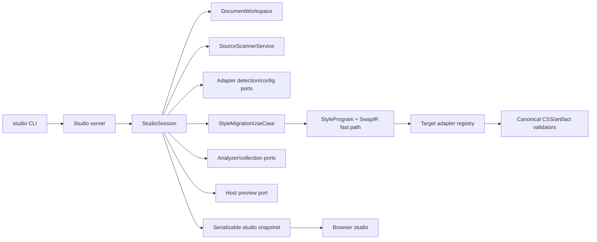

# Local codebase studio plan

**Status: IN PROGRESS.** This plan refines the idea of a CLI-spawned playground
for the current repository. It is a tooling feature; it does not change the
frozen `tw()` / `css()` / `cx()` / design runtime API.

## Progress

- **Wave 1 — contracts/composition root:** implemented. Studio session,
  snapshot, adapter-catalog, workspace, evaluator, server, and preview ports
  are versioned and independently injectable.
- **Wave 2 — local server/workspace:** implemented with authenticated
  localhost transport, shared source workspace/scanner reuse, in-memory
  overlays, watcher refresh, and disk-conflict reporting.
- **Wave 3 — static surfaces:** implemented for source/target output,
  semantic `StyleProgram` evidence, canonical CSS, discovered theme scopes,
  diagnostics, and a registry-driven adapter UI.
- **Wave 4 — host preview:** boundary and unavailable-state contract are
  implemented; a real React/Vite host adapter remains before this plan is
  complete.
- **Wave 5 — framework expansion:** pending until the first host adapter is
  proven.
- **Wave 6 — hardening/documentation:** focused Studio tests, package
  typecheck/build, and a repository-local benchmark exist; Playwright-BDD,
  release documentation, and formal performance baselines remain.

## Context

Pandwind already has the important pieces, but they are exposed separately:

- the playground evaluates small in-memory examples and hosts the migration
  lab;
- the inspector gathers coverage, CSS diagnostics, token graphs, provenance,
  and usage analytics;
- the shared source workspace and scanner provide language-neutral documents;
- the codemod registry can detect source adapters, load project context, and
  route a semantic program to a target adapter;
- the bundler integrations can produce the actual static CSS artifact in a
  host application.

What is missing is one local session that composes those existing ports around
the user's current codebase. The feature must not become a second scanner,
second migration engine, or an unsafe arbitrary-code evaluator.

## Goal

Provide one local command that opens a browser studio for a repository, where a
user can inspect and edit supported style source in memory, see the resulting
semantic program and generated CSS, switch migration targets and themes, and
observe a supported host preview update without modifying the source tree.

## What

Add a published tooling entry point, tentatively:

```sh
pandwind studio [project-root]
```

The command starts a localhost-only studio server and opens or prints its URL.
The server creates a `StudioSession` from the current project root and exposes
the following views:

1. **Source workspace** — browse supported source documents, select a style
   call or component, and edit a virtual copy in Monaco.
2. **Semantic view** — show the matched `StyleProgram` / flat `SwapIR` result,
   source ranges, conditions, themes, composition, dynamic values, and
   provenance.
3. **CSS view** — show canonical source CSS, target CSS, generated artifacts,
   rule ordering, CSS byte/gzip deltas, and residuals.
4. **Migration view** — auto-detect the source adapter, load its official
   project configuration when available, choose any registered target, and
   preview `css.class`, `dss`, `tw`, or another registered target adapter.
5. **Design-system view** — browse raw, semantic, scope, and component token
   layers; switch discovered theme scopes; inspect token/property/condition
   usage; and see which rules change.
6. **Component/style tree** — show a static source-derived component tree with
   style call sites linked to semantic programs and emitted rules. When an
   explicit host preview is available, show the corresponding rendered tree
   and computed-style/provenance links.
7. **Diagnostics** — show configuration failures, unsupported capabilities,
   residuals, stale imports, and validation differences with file/line links.

The studio reuses the existing playground components where their contract is
appropriate and the inspector's collection views where their payload is
appropriate. The browser receives serializable snapshots and never receives
Node filesystem, module-loader, or official-config implementation code.

## Why

Running a codemod is the right operation for committing a migration, but it is
too expensive and irreversible as the first feedback loop. A local studio
would make the pivot inspectable before users change thousands of files:

- users can compare target APIs on one real source selection;
- adapter and configuration mistakes become visible before a write;
- custom tokens, themes, plugins, and residuals are inspectable rather than
  hidden behind a CLI report;
- the same session can explain generated CSS and the component/style site that
  caused it;
- maintainers can reproduce migration bugs with an editable input snapshot.

The expert boundary is important: static source analysis can always show a
component/style tree, but it cannot guarantee a visual preview for an
arbitrary application without running that application's framework and build
environment. The studio therefore treats runtime preview as an explicit host
integration, not as a claim that AST evaluation is equivalent to rendering.

## How

### Architecture

The CLI is only a composition root. The session depends on ports and existing
registries:



The central port is conceptually:

```ts
interface StudioSession {
	open(request: StudioOpenRequest): Promise<StudioSnapshot>;
	edit(request: StudioEditRequest): Promise<StudioSnapshot>;
	select(request: StudioSelection): Promise<StudioSnapshot>;
	switchTarget(request: StudioTargetSelection): Promise<StudioSnapshot>;
	switchTheme(request: StudioThemeSelection): Promise<StudioSnapshot>;
	subscribe(listener: (event: StudioEvent) => void): () => void;
	close(): Promise<void>;
}
```

The exact public types should be finalized during implementation. The session
must delegate to the existing source scanner, adapter registry, official
config loaders, semantic lowering registry, validator registry, and collection
facade. It must not contain ecosystem branches or duplicate extension/parser
logic.

### Live updates

- Watch the project through the existing filesystem/workspace ports.
- Cache parsed documents and resolved config by content/config hash.
- Invalidate only affected documents, import descendants, token scopes, and
  target artifacts.
- Debounce editor changes and cancel stale evaluations.
- Send compact snapshot patches to the browser; keep large source/CSS payloads
  requestable by id.
- If the disk changes while a document is edited in memory, show a conflict
  and require an explicit reload or keep-editing decision. Never overwrite the
  user's file.

### Migration preview

The migration view runs the existing route:

```text
source detection
  -> official project context
  -> source adapter
  -> StyleProgram / SwapIR
  -> target lowering
  -> target adapter
  -> validation and residual report
```

Target selection is registry-driven. `css.class`, `dss`, and `tw` are target
dialects owned by the Pandwind adapter family; future targets are added by
registration, not by editing the studio. Auto-detection is evidence-based and
must display ambiguity instead of silently picking an adapter.

### Preview modes

The first release should provide two distinct modes:

- **Static mode (required):** source-derived component/style tree, semantic
  output, canonical CSS, generated target artifacts, and diagnostics. It works
  without running the user's application.
- **Host mode (optional per framework):** connect to an explicitly configured
  dev server or host adapter, inject the in-memory generated artifact, and
  collect rendered tree/computed-style evidence. It must use the host's
  official build/runtime path and remain isolated in an iframe or equivalent
  boundary.

The studio does not execute arbitrary source with `eval`, invent a React/Vue/
Svelte runtime, or claim browser parity when only static analysis ran.

### Security and lifecycle

- Bind to localhost by default and use a per-session capability token.
- Do not upload source, config, tokens, or CSS to a remote service.
- Keep project-module loading on the server behind existing official-loader
  ports; serialize only validated results.
- Default to read-only. A later, separately approved action may apply a
  reviewed codemod patch, but this plan does not add source writes.
- Close watchers, child processes, browser sessions, and caches on shutdown.

## What this allows

- Fast feedback on a real project's actual style calls and generated CSS.
- Interactive comparison of migration targets and Pandwind API dialects.
- Real custom-token/theme/config inspection rather than default-only examples.
- Immediate visibility into residuals, lossiness, provenance, and CSS-size
  changes.
- Reproduction of adapter issues as small editable source cases.
- Incremental project-wide inspection without reparsing the repository for
  every browser interaction.
- Optional browser/computed-style proof where a framework host integration is
  configured.

## What this does not allow

- It does not make unsupported source semantics safe by hiding residuals.
- It does not replace the write-mode codemod or the official bundler plugin.
- It does not promise a visual preview for every framework or arbitrary build
  setup in the first release.
- It does not execute untrusted project code inside the studio UI.
- It does not become a devtools extension, cloud service, or persistent design
  system database.
- It does not add a second public runtime styling API.

## UI & UX

The studio should feel like a focused local workbench rather than a second
documentation playground:

- left rail: project files, detected adapter, and component/style tree;
- center: source editor with inline diagnostics and source ranges;
- right rail: target selector, theme/token controls, semantic output, and
  residuals;
- bottom drawer: generated CSS, canonical diff, artifact files, and validation
  details;
- optional preview tab: rendered host iframe with computed-style and rule
  provenance links.

Selections must be URL-addressable for bug reports, but source content remains
local. Advanced controls such as target capability details, raw IR, and
artifact manifests should be progressively disclosed.

## Data model

The session snapshot should be serializable and versioned, with references to
large payloads:

- `StudioProjectSnapshot` — root identity, detected framework/language
  documents, config status, and watcher revision;
- `StudioSelection` — document, source range, component/style site, and target;
- `StudioSemanticSnapshot` — `StyleProgram` or `SwapIR`, source map, outcomes,
  capabilities, and lossiness;
- `StudioArtifactSnapshot` — canonical source/target CSS, generated files,
  hashes, byte metrics, and rule provenance;
- `StudioThemeSnapshot` — token layers, scoped variables, active theme, usage
  counts, and affected rules;
- `StudioTreeSnapshot` — static component/style tree plus optional host DOM
  evidence;
- `StudioDiagnostic` — typed configuration, parse, lowering, validation, or
  host-preview issue with source provenance.

All snapshot schemas need explicit versions. No raw AST or module instance is
sent to the browser.

## Implementation steps

### Wave 1 — contracts and composition root

- Define the studio session, snapshot, event, and host-preview ports.
- Decide whether the published command lives in `pandwind-analyze` or a small
  tooling package, without importing studio code into the shipped runtime.
- Reuse the existing registry and collection facades.
- Add substitution tests proving a fake workspace, scanner, migration route,
  and preview host can drive the session.

### Wave 2 — local server and workspace session

- Add the localhost CLI/server lifecycle and capability-token boundary.
- Connect `DocumentWorkspace`, shared scanner, watcher, config loaders, and
  incremental invalidation.
- Add conflict handling for disk changes versus in-memory edits.
- Add unit and integration tests for cancellation, cache reuse, and shutdown.

### Wave 3 — static studio surfaces

- Mount the existing editor and migration UI in a studio shell.
- Add source selection, static component/style tree, semantic output, CSS
  output, diagnostics, provenance, and artifact downloads.
- Add target and theme switching against real loaded project metadata.
- Add inline-snapshot cases for static, dynamic, custom-token, multi-theme,
  configuration-failure, and unsupported-capability inputs.

### Wave 4 — host preview adapters

- Define a host-preview adapter contract.
- Implement one well-supported React/Vite host first using the existing
  bundler plugin and an isolated iframe.
- Capture computed-style, responsive/pseudo-state, CSS-size, and injection
  provenance evidence.
- Add a clear unavailable state for projects without a supported host adapter.

### Wave 5 — framework and ecosystem expansion

- Add host adapters only when a framework's build/runtime lifecycle can be
  isolated and validated.
- Reuse the same static session for Vue, Svelte, Astro, Solid, and other
  languages; do not add framework branches to the semantic core.
- Add official-config fixture projects and real-repository smoke sessions.

### Wave 6 — hardening and documentation

- Add Playwright-BDD `.feature` coverage for opening a project, editing a
  style, switching targets/themes, viewing CSS, seeing residuals, and host
  preview updates.
- Add performance tests for cold open, warm edit, cache hit, files/sec, peak
  memory, and cancellation latency.
- Document `pandwind studio`, read-only behavior, host configuration, and
  limitations.
- Add package/build/typecheck/lint/Knip gates and a release smoke test.

## Open questions

- Should the command be a subcommand of `pandwind-analyze` or a separate
  `pandwind-studio` package to keep the analyzer CLI small?
- Should host mode attach to an already-running dev server, start a configured
  command, or support both through one host port?
- Which framework gets the first host adapter after React/Vite?
- Should a selected source edit be able to span multiple files immediately, or
  should multi-file edits begin as a read-only generated-artifact preview?
- What maximum repository size should enable project-wide tree generation, and
  when should the UI switch to selection-first loading?

## Acceptance criteria

- `pandwind studio` starts locally from a real repository and shuts down cleanly.
- No browser bundle contains Node filesystem/path/module-loader code.
- The session uses the shared workspace/scanner and does not duplicate parser,
  glob, or extension logic.
- Source adapter detection and official config loading are visible, typed, and
  fail with structured diagnostics when unavailable.
- Editing a supported style updates semantic output, generated CSS, residuals,
  token usage, and the static component/style tree without writing files.
- Switching among `css.class`, `dss`, `tw`, and registered external targets
  uses the existing adapter registry and preserves the flat `SwapIR` fast path.
- Imported CSS themes, custom tokens, multiple scopes, `@source inline`, and
  container-query conditions remain visible and are not flattened incorrectly.
- Every generated artifact has provenance and canonical CSS/size metrics.
- A supported host preview proves at least one real visual/computed-style
  update; unsupported hosts show an explicit unavailable state.
- Unit, integration, Playwright-BDD, typecheck, lint, format, Knip, and focused
  performance gates pass.
- The studio never silently drops an unsupported semantic: it preserves the
  source representation or reports a typed residual.

## Decisions log

- **2026-09-03 — Static mode is mandatory; host mode is optional.** A source
  tree and semantic/CSS preview are broadly reusable. Runtime visual parity
  requires a real framework host and cannot be safely simulated for arbitrary
  code.
- **2026-09-03 — Read-only by default.** The codemod remains the explicit
  source-writing operation; the studio is a safe preview and debugging loop.
- **2026-09-03 — Reuse existing ports and registries.** The feature must not
  create another scanner, migration engine, config resolver, or runtime API.
- **2026-09-03 — Local-only session.** Source, configuration, token values, and
  generated CSS remain on the user's machine.
- **2026-09-03 — Keep both `StyleProgram` and flat `SwapIR`.** Rich semantic
  inspection uses `StyleProgram`; simple cases retain the cheap compatibility
  path.
