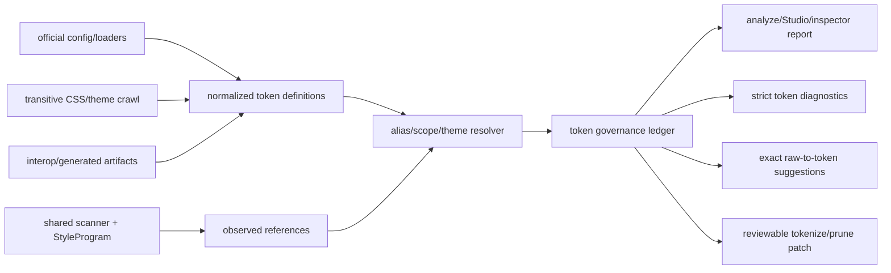
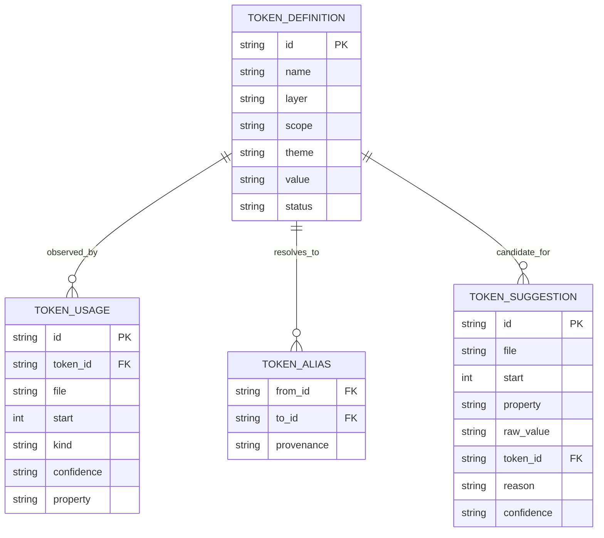

# Token usage and governance plan

## Context

Pandwind already has several useful pieces of token analysis:

- the collection layer counts authored `$token` references in `tw()` and
  `css()` call sites;
- inspector analytics reports token usage, top properties, property/value
  combinations, and conditions;
- a supplied token universe can expose zero-use tokens;
- the inspector can generate a read-only `.changeset` proposal for unused
  tokens;
- the token graph tracks aliases, scopes, dangling references, and orphaned
  raw values; and
- the codemod tokenization path can rewrite some exact raw values to authored
  preset tokens.

The current implementation is not yet a complete token-governance feature.
The token universe is not uniformly derived from every project's effective
official configuration, strict-token policy is not represented as a first
class report, raw values are not systematically matched to safe target tokens,
and zero usage does not by itself prove that a token can be deleted. The
current source analytics also has to distinguish statically observed usage
from dynamic, generated, exported, or framework-hidden usage.

Related work:

- plan 023 — inspector usage analytics and design-system reporting;
- plan 044 — official configuration and project context;
- plan 052 — ecosystem correctness and adapter-owned configuration;
- plan 053 — local codebase Studio and its design-system view.

The feature must preserve the frozen runtime API. This is analyzer, inspector,
lint, codemod, and Studio tooling, not a new runtime token API.

## Goal

Give maintainers a trustworthy, configuration-aware answer to: which tokens
are defined, which are actually used, which usages are strict or raw, which
raw values can be safely replaced, and which definitions may be removed or
need human review.

The system must prefer an explicit unknown result over a false claim of zero
usage or an unsafe token conversion.

## What

Add a shared token-governance analysis and report contract consumed by the
analyzer, inspector, Studio, lint plugin, and tokenization codemod.

The report covers:

1. **Token definitions** — every statically resolved token from the effective
   project configuration, imported CSS theme, generated interop artifact, or
   declared token format, with source, layer, scope, theme, aliases, and
   provenance.
2. **Observed usage** — direct token references, semantic aliases, component
   recipes, generated utilities, CSS variable references, and target-specific
   references, each with file/range and confidence.
3. **Strictness** — whether a value is a verified token reference, an allowed
   raw escape hatch, a raw value in a strict context, or unknown because the
   project policy/configuration could not be evaluated.
4. **Raw-value candidates** — exact, property-aware, scope-aware suggestions
   from raw literals to tokens. Suggestions are emitted only when the target
   token resolves to the same value and its spelling is legal for that
   property and active theme.
5. **Unused candidates** — tokens with no reachable static usage after alias,
   composition, generated-artifact, export, and dynamic-boundary analysis.
   Candidates are classified as safe-to-remove, review-required, or not
   removable rather than presented as one undifferentiated list.
6. **Coverage boundaries** — dynamic expressions, runtime theme access,
   generated CSS, public exports, safelists, plugin output, and failed
   configuration loads that prevent a definitive usage claim.

The first release is report-first. It may generate a reviewable codemod patch
or changeset, but it must not delete definitions automatically by default.

## Why

Design systems decay in two opposite ways: useful tokens become invisible
because code falls back to literals, and unused tokens accumulate because no
one can tell whether they are still reachable. A trustworthy report enables
incremental cleanup without breaking themes, plugins, or generated output.

The expert safety boundary is important: a token with zero references in
scanned source is not necessarily dead if it is exported publicly, consumed by
generated CSS, selected dynamically, referenced by a plugin, or required by an
unscanned host. The report must make those boundaries visible instead of
optimizing for an attractive but unsafe unused count.

## How

### Conceptual model



The central ledger is neutral. Ecosystem loaders provide definitions and
policy; scanner/language adapters provide usage; target policies decide which
token spelling is legal. No shared orchestrator contains Panda, Chakra,
Tailwind, UnoCSS, or other ecosystem branches.

### Operations / behavior

#### Build the effective token universe

- Use the official project loader when the adapter provides one.
- Merge reachable imported CSS themes and generated interop metadata.
- Normalize only statically resolved scalar values into the existing
  `AdapterTokenCatalog` shape.
- Retain conditional/theme-dependent objects as scoped definitions; never
  flatten their condition keys into invented token names.
- Record loader failures, unresolved imports, plugin boundaries, and unknown
  generated sources as diagnostics that downgrade certainty.
- Deduplicate definitions by canonical identity while retaining all
  provenance locations.

#### Collect usage

- Consume the shared document workspace and scanner rather than direct glob,
  parser, or extension logic.
- Resolve aliases and namespaces through AST bindings and the semantic
  `StyleProgram` where available.
- Count direct authored tokens, semantic aliases, recipe/variant references,
  CSS custom-property references, generated candidates, and artifact roots.
- Preserve file, range, adapter, property, scope, active theme, and usage
  kind for every observation.
- Mark dynamic expressions and incomplete scans as unknown coverage instead of
  treating them as unused.

#### Classify strict and raw values

Use explicit effective policy from the source adapter:

- **token** — verified reference to a definition;
- **raw-allowed** — literal allowed by the active policy or intentional
  `$raw`/arbitrary-value escape hatch;
- **raw-strict-violation** — literal in a property/context that requires a
  token;
- **unknown** — policy or value resolution is incomplete;
- **dynamic** — value depends on runtime input and cannot be proven static.

The default when no strict policy is known is report-only/fail-open. Pandwind
must not invent strictness from a guessed preset.

#### Suggest exact token replacements

For each raw scalar value, candidate matching must require:

- exact resolved value equality after the target's normalization rules;
- compatible CSS property/category;
- compatible scope and active theme, or an explicit all-theme proof;
- legal target token spelling;
- no ambiguity between multiple candidates;
- no loss of intentional arbitrary-value semantics.

Rank suggestions by explicit target metadata, semantic-token preference, then
shortest stable spelling. Do not suggest a token merely because its name looks
similar. Suggestions include confidence, reason, and the source/target
provenance needed for a review.

#### Propose unused-token cleanup

- Report zero-use definitions only after traversing aliases, composition,
  recipes, generated artifacts, exports, and known dynamic boundaries.
- Classify public/exported tokens and tokens referenced by unknown boundaries as
  review-required, never safe-to-remove.
- Generate a deterministic removal patch or changeset preview.
- Deduplicate edits and fail closed on conflicting generated files.
- Keep deletion opt-in and require a clean validation run after applying it.

### Tech choices

| Choice           | Decision                                               | Rationale                                                                                      |
| ---------------- | ------------------------------------------------------ | ---------------------------------------------------------------------------------------------- |
| Token universe   | Official loaders plus transitive CSS/artifact adapters | Custom presets and generated tokens must be real project context, not hardcoded defaults       |
| Usage extraction | Shared scanner + AST/StyleProgram evidence             | Regex is acceptable only as a bounded fallback; semantic binding and ranges need AST ownership |
| Unknown handling | Explicit confidence/coverage states                    | Zero usage is unsafe when runtime/plugin/generated behavior is hidden                          |
| Raw conversion   | Exact property-aware matching only                     | Idiomatic output matters, but semantic equivalence outranks token aesthetics                   |
| Removal          | Report and reviewable patch first                      | Automatic deletion can break exports, dynamic access, and external consumers                   |
| Runtime API      | No change                                              | Governance belongs in analyze, Studio, lint, and codemod tooling                               |

### Architecture

```text
TokenSourceRegistry
  -> EffectiveTokenContextPort
  -> TokenUsageCollectorPort
  -> TokenReachabilityPort
  -> TokenPolicyPort
  -> RawTokenSuggestionPort
  -> TokenGovernanceReport
       -> Analyzer renderer
       -> Inspector/Studio UI
       -> Lint diagnostics
       -> Codemod tokenize/prune planner
```

Each ecosystem owns its loader and policy adapter. The governance service only
coordinates ports and consumes neutral token definitions and usage facts.
Existing `TokenCatalog`, `StyleProgram`, `SourceScannerService`, and
`CollectionToolkit` remain the implementation foundations; this plan does not
create a second token graph or a second scanner.

## What this allows

- See all effective tokens with direct, indirect, generated, dynamic, and
  unknown usage states.
- Distinguish verified token usage, allowed raw values, strict violations, and
  unresolved cases.
- Find the most-used and never-used tokens by theme, scope, layer, property,
  adapter, and source location.
- Get safe raw-to-token suggestions that preserve exact semantics.
- Generate deterministic tokenization patches and unused-token removal
  proposals without silently rewriting source or deleting definitions.
- Use the same ledger in the analyzer, inspector, Studio, lint plugin, and
  codemod.

## What this does not allow

- It cannot prove a token is dead when the project exposes arbitrary dynamic
  lookup, external consumers, plugin-generated CSS, or unscanned files.
- It does not flatten theme-dependent values into a single global token.
- It does not guess token names, strictness, or custom configuration from
  built-in defaults.
- It does not make arbitrary runtime values statically extractable.
- It does not add a runtime token API or change `tw()`, `css()`, `cx()`, or
  `createDesignCss`.
- It does not delete tokens automatically without an explicit write-mode
  request and a post-change validation pass.

## UI & UX

### Desktop

Add a Token governance view to Inspector and Studio:

```text
tokens  184 defined · 137 used · 21 raw strict violations · 26 unknown
--------------------------------------------------------------------------
filters: [theme] [scope] [layer] [status] [property] [adapter]

token                  uses   status             source / actions
$colors.brand           82    used               config · view usages
$spacing.card            0    safe candidate     preset · propose removal
$colors.legacy           ?    review required    dynamic lookup · inspect

raw value suggestions: 14 exact matches · review / apply selected
strict policy: report-only (configuration source: official loader)
```

Every count links to source ranges and provenance. “Unused” is labelled as a
candidate, with the reason it is safe or requires review. Configuration failure
is visible at the top of the view and changes the wording from “unused” to
“not observed in the scanned graph.”

### Mobile

Use summary cards for defined/used/raw/unknown, followed by a filterable list.
Open a token to see usages, aliases, themes, scopes, candidate replacements,
and the proposed patch. Keep bulk removal behind an explicit review action.

### Common interactions

| Action                   | Result                                                                      |
| ------------------------ | --------------------------------------------------------------------------- |
| Filter by `unused`       | Shows only zero-observed definitions and their safety class                 |
| Open a token             | Shows usages, aliases, source ranges, themes, and provenance                |
| Select a raw suggestion  | Shows exact-value proof and target output before applying                   |
| Generate cleanup         | Produces a deterministic patch/changeset preview; writes nothing by default |
| Change active theme      | Recomputes scoped usage and raw-value candidates                            |
| Inspect unknown coverage | Shows dynamic/plugin/export/config boundaries that prevent proof            |

## Data model



The serialized report must be versioned and compact. Large usage lists should
be requestable by token/file id in Studio rather than embedded in every live
snapshot.

## Implementation steps

1. Define the versioned neutral governance contracts: definitions, usage facts,
   strictness, confidence, unknown boundaries, suggestions, removal
   candidates, and report provenance.
2. Adapt official loader output, imported CSS themes, and interop artifacts
   into one effective token context with explicit failure diagnostics.
3. Replace the current ad-hoc token-universe plumbing with the context port,
   while preserving existing usage counts and token graph output.
4. Add AST/StyleProgram usage collection for aliases, semantic tokens,
   conditions, recipes, CSS variables, generated artifacts, and dynamic
   boundaries; retain a bounded fallback for unsupported source formats.
5. Implement strict/raw policy resolution for Panda, Chakra, Tailwind, UnoCSS,
   Tokenami, Pandwind, and the remaining adapters that expose an equivalent
   policy. Unknown policy must remain report-only.
6. Implement exact property/theme/scope-aware raw-to-token suggestions and
   inline-snapshot tests for positive, ambiguous, cross-theme, and rejected
   matches.
7. Implement reachability classification and deterministic removal plans,
   including aliases, recipes, exports, plugin/generated boundaries, dynamic
   access, and conflicting edits.
8. Integrate the report into `analyze`, Inspector, Studio, and the existing
   lint/codemod paths. Keep the UI and CLI read-only unless a write mode is
   explicitly selected.
9. Add contract, unit, integration, and browser tests for each loader/policy
   adapter, plus real custom-theme corpora and generated-output fixtures.
10. Add coverage gates: every registered token source has a universe test,
    every strictness state has a fixture, every removal class has a safety test,
    and no unknown boundary may be counted as unused.
11. Benchmark large token catalogs and repository scans, then document the
    report semantics and safe cleanup workflow.

## Open questions

1. Which project policy names should map to strictness states when an ecosystem
   has runtime enforcement but no static official API?
2. Should the first write-mode implementation emit only patches, or also offer
   a separate explicitly approved token-removal command?
3. Which generated artifacts are authoritative for each adapter when source
   config and checked-in output disagree?
4. What repository-size threshold should switch Inspector/Studio from full
   usage lists to paginated token/file queries?

## Acceptance criteria

- [x] The analyzer can show the effective token universe with provenance from
      official config, imported CSS, and generated interop artifacts.
- [x] Every token is classified as used, unused candidate, exported/review,
      dynamic/unknown, or configuration-unknown; no unknown boundary becomes a
      false unused result.
- [x] Strict-token contexts distinguish verified tokens, allowed raw values,
      strict violations, dynamic values, and unknown policy.
- [x] Raw-to-token suggestions require exact value, property, scope, theme,
      and spelling compatibility, with ambiguity rejected.
- [x] Alias, semantic, recipe, composition, CSS-variable, generated, and
      plugin references contribute to reachability where they are statically
      provable.
- [x] Removal output is deterministic, provenance-linked, deduplicated, and
      read-only by default; unsafe candidates produce review reasons.
- [x] Inspector and Studio expose usage counts, unused candidates, raw
      suggestions, strictness, unknown coverage, and token provenance.
- [x] Lint and codemod integrations consume the shared governance report rather
      than maintaining independent token heuristics.
- [x] Each registered source loader and policy adapter has happy, ambiguous,
      dynamic, configuration-failure, and custom-theme tests with inline
      snapshots plus ordinary assertions.
- [x] Performance and memory remain bounded on large token catalogs and
      repository-scale scans.

## Decisions log

| Date       | Decision                                                                 | Rationale                                                                                              |
| ---------- | ------------------------------------------------------------------------ | ------------------------------------------------------------------------------------------------------ |
| 2026-09-03 | Treat token governance as a shared tooling ledger, not a runtime feature | The frozen runtime API stays small while analyzer, Studio, lint, and codemod share one source of truth |
| 2026-09-03 | Report unknown boundaries explicitly                                     | Dynamic lookup, plugins, exports, and generated CSS make naive zero-use claims unsafe                  |
| 2026-09-03 | Require exact property/theme-aware token matches                         | A plausible token name is not evidence of semantic equivalence                                         |
| 2026-09-03 | Make cleanup report-first and write-mode opt-in                          | Token deletion can affect external consumers and runtime behavior                                      |
| 2026-09-03 | Use official project context at adapter boundaries                       | Hardcoded defaults cannot represent custom themes, presets, or strictness policy                       |
| 2026-09-04 | Ship the ledger as one versioned report consumed by CLI, Inspector, lint, and codemod | One shared source of truth beats four independent token heuristics and keeps the runtime API frozen |
| 2026-09-04 | Gate codemod tokenize on exact report suggestions                        | When suggestions are supplied the heuristic fallback is disabled instead of merged, so report-verified pairs only |
| 2026-09-04 | Keep the lint policy a structural mirror without a dependency            | The plugin consumes a plain snapshot; the composition root owns governance wiring |
| 2026-09-04 | Keep Studio exposure at the shared-report level for now                  | Paginated queries for very large catalogs and a write-mode removal command are bounded follow-ups in their owning plans |
| 2026-09-04 | Bound repository-scale cost with a committed bench                       | 2k definitions / 400 files / ~16k sites run ~4.9s per full pass; the bench guards future regressions |
