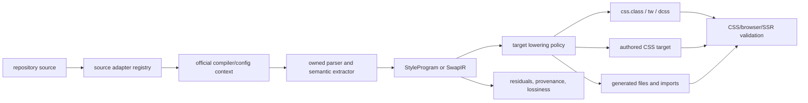
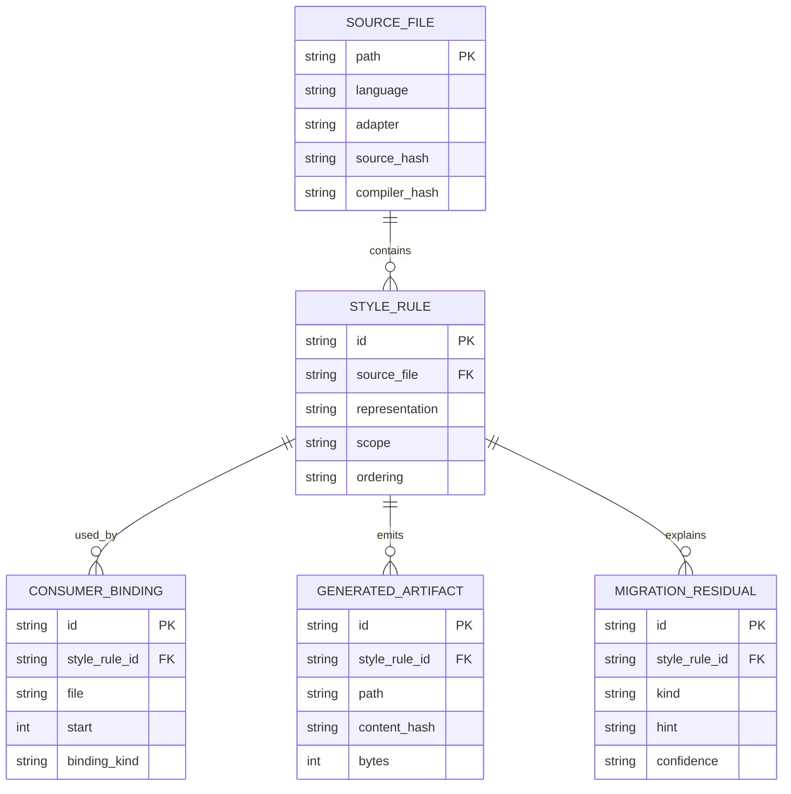

# Non-CSS-in-JS source adapters plan

## Context

Pandwind's current built-in codemod registry covers many CSS-in-JS and
utility-style ecosystems, including Panda, StyleX, Emotion,
styled-components, Vanilla Extract, Stitches, Linaria, JSS, Fela, Goober,
Aphrodite, Treat, Compiled, Chakra UI, MUI, Mantine, Tailwind, Tokenami, and
UnoCSS. The registry currently has no dedicated source adapter for:

- Tamagui;
- CSS Modules;
- Sass/SCSS;
- Less; or
- authored/raw CSS as a source language.

Vanilla Extract already has an adapter, official API-family fixtures, and
basic bidirectional matrix coverage. That is not the same as complete support:
custom sprinkles, theme contracts, generated files, recipe composition,
project configuration, and real browser/SSR promotion still need deeper proof.

These sources are related but are not one semantic family:

- Tamagui is a component and design-system runtime/compiler with host and
  configuration semantics.
- CSS Modules are static CSS plus a class-name/export transformation.
- Sass and Less are preprocessing languages with variables, mixins, imports,
  functions, nesting, and control flow.
- raw CSS is already the platform stylesheet language and often should remain
  authored CSS rather than being forced into a CSS-in-JS carrier.
- Vanilla Extract is a compile-time CSS-in-TS system with contracts,
  generated identifiers, and rule-level APIs.

The work must follow the existing pivot architecture:

- one independently owned adapter/plugin per source family;
- official package/config loading through project ports where available;
- AST or stylesheet-parser ownership for semantic rewrites;
- `StyleProgram` for semantic rules and the flat `SwapIR` fast path for simple
  declarations;
- target-owned output for `css.class`, `tw`, `dcss`, authored CSS, and other
  registered targets; and
- typed lossiness/residual reporting whenever a transformation cannot be
  proven equivalent.

Related work:

- plan 040 — any-to-any semantic lowering;
- plan 041 — adapter completeness and bidirectional routes;
- plan 044 — AST, official config, and project context;
- plan 052 — ecosystem correctness;
- plan 054 — token usage and governance;
- `docs/src/content/docs/interop/official-api-matrix.md` — current API evidence.

## Goal

Make Tamagui, CSS Modules, Sass/SCSS, Less, raw CSS, and advanced Vanilla
Extract projects first-class, evidence-backed source lanes without claiming
that preprocessing or component semantics can be erased when they cannot.

Every adapter must either produce idiomatic target code with executable parity
proof or preserve the source and explain the exact residual.

## What

Add six independently registered source-adapter tracks:

1. `tamagui` — static style props, `styled` declarations, tokens, themes,
   variants, media conditions, and compiler/config context.
2. `css-modules` — `.module.css`/`.module.scss` style definitions, imported
   class bindings, composition, and class-name usage rewrites.
3. `sass` — `.sass`/`.scss` source with compiler-aware extraction and safe
   conversion of provably local static rules.
4. `less` — `.less` source with compiler-aware extraction and safe conversion
   of provably local static rules.
5. `css` — authored CSS source, including local class rules and rule-level
   constructs that should remain authored CSS when Pandwind is not the right
   carrier.
6. `vanilla-extract` — expanded project-aware and generated-output checks for
   the existing adapter.

The first five are source adapters, not promises that every source file must
be converted. Sass/Less and raw CSS need an explicit “keep authored CSS” target
lane for constructs whose natural target is still CSS.

## Why

Users frequently combine CSS-in-JS with the adjacent static styling ecosystem.
A pivot library that cannot explain CSS Modules, preprocessors, or raw CSS
leaves a large amount of real application styling outside the migration graph.
Tamagui is also a significant component/design-system source that shares
tokens and style props with Panda/Chakra-like systems.

The expert boundary is equally important: compiling Sass or Less to CSS and
then guessing a Pandwind object is not a lossless migration. Mixins, variable
scope, selector generation, source-order behavior, and runtime component
props can materially change semantics. The adapter must preserve those forms,
or keep them as authored CSS with a typed residual, instead of deleting them
to make a fixture pass.

## How

### Conceptual model



### Operations / behavior

#### Tamagui

- Detect official Tamagui package imports and configured generated/runtime
  entrypoints through bindings, including aliases and namespaces.
- Load the effective Tamagui configuration through the project's installed
  official packages and compiler context, never a hardcoded token/prop list.
- Normalize verified tokens, shorthands, media conditions, themes, variants,
  and static style props into `StyleProgram` metadata.
- Convert statically provable style props to the target's idiomatic host
  carrier, preserving component behavior and ordinary props.
- Keep `styled` subjects, responsive runtime hooks, function-valued props,
  dynamic theme lookup, and compiler-only transforms behind host/runtime
  contracts unless a target adapter proves an equivalent form.
- Test the actual documented Tamagui APIs only after verifying them against
  the pinned official package and documentation.

#### CSS Modules

- Parse CSS Module files with a stylesheet parser and preserve local/global
  scoping, composition, `:global`, `:local`, layers, nesting, keyframes,
  `@value`, and source order as rule-level semantics.
- Resolve imported bindings in TS/JS/JSX/Vue/Svelte/Astro files through the
  shared scanner and AST bindings.
- Convert a simple local class used as a class binding to `css.class` or a
  target-native class carrier, generating a shared file only when the style is
  reused across modules.
- Preserve class composition as `cx`, target composition, or explicit
  generated artifacts according to the target adapter.
- Keep CSS-module hashing and public class exports when a host or external CSS
  consumer depends on them; never replace a public class contract silently.
- Treat CSS Modules as a static CSS source, not as a CSS-in-JS runtime.

#### Sass/SCSS and Less

- Detect extensions and imports through language adapters, not central
  extension switches.
- Load the installed official compiler and project include paths/importers
  through injectable project ports.
- Capture compiler output and source maps as validation evidence.
- Convert only rules whose declarations, selectors, and dependencies can be
  traced exactly to a local static source range.
- Preserve variables, mixins, functions, loops, interpolation, extends,
  conditional compilation, import resolution, and generated selector graphs
  unless a dedicated semantic lowering proves equivalence.
- Offer authored-CSS output as the safe target for remaining constructs and
  emit a residual pointing to the compiler feature that was preserved.
- Ensure the codemod never replaces a source preprocessor file with a partial
  generated stylesheet while dropping the source-level generator.

#### Raw/authored CSS

- Parse stylesheets into the versioned rule-level semantic IR.
- Convert simple local class rules to Pandwind class carriers only when all
  declarations, selectors, conditions, ordering, and references are proven.
- Keep globals, keyframes, fonts, layers, supports, complex selectors,
  custom properties, and browser-specific rules in authored CSS when that is
  the expert target form.
- Rewrite consumers only when class-name and cascade behavior remain stable.
- Support CSS, React, Vue, Svelte, Astro, and other host binding forms through
  host adapters rather than framework branches in the CSS adapter.
- Treat raw CSS as a legitimate target and source representation, not an
  automatically inferior form.

#### Vanilla Extract expansion

- Resolve project-generated files and compiler output in addition to source
  syntax.
- Test `style`, `styleVariants`, `recipe`, `globalStyle`, `keyframes`,
  `fontFace`, `createVar`, `assignVars`, `createThemeContract`, `createTheme`,
  sprinkles, and custom package wrappers using verified official APIs.
- Preserve theme contracts and variable references through the token/context
  ports; never flatten conditional values into invented global tokens.
- Validate generated CSS, browser computed styles, SSR output, hydration, and
  size for custom themes, variants, recipes, and reused variables.
- Distinguish a generated artifact that is authoritative from stale or
  missing output and report configuration residuals accordingly.

### Tech choices

| Choice                | Decision                                                           | Rationale                                                                         |
| --------------------- | ------------------------------------------------------------------ | --------------------------------------------------------------------------------- |
| Tamagui context       | Official installed packages/config through project ports           | Tokens, shorthands, themes, and compiler behavior are project-specific            |
| Stylesheet parsing    | CSS parser plus Sass/Less compiler/source-map ports                | Regex cannot safely own nesting, interpolation, composition, or cascade           |
| Preprocessor target   | Keep authored CSS for unlowerable constructs                       | Compiled output is not proof that source-level generation can be deleted          |
| CSS Modules identity  | Preserve local/export contracts until consumer rewrites are proven | Hashing and composition can be public behavior                                    |
| Raw CSS               | First-class source and target representation                       | The platform stylesheet remains the correct expert output for rule-level features |
| Vanilla Extract proof | Source, generated artifact, browser, SSR, hydration, and size      | Syntax snapshots alone do not prove project-level compiler parity                 |

### Architecture

```text
CodemodPluginRegistry
  -> TamaguiSourceAdapter
  -> CssModulesSourceAdapter
  -> SassSourceAdapter
  -> LessSourceAdapter
  -> AuthoredCssSourceAdapter
  -> VanillaExtractSourceAdapter

Each adapter owns:
  detection -> context loading -> parsing -> StyleProgram/SwapIR mapping
  -> target requests -> generated artifacts -> residuals -> validation

Shared orchestration owns only:
  workspace -> route -> lowering -> artifact merge -> report
```

No `cli.ts`, migration runner, generic stylesheet helper, or corpus runner may
contain Tamagui/CSS-Modules/Sass/Less/Vanilla-Extract policy branches.

## What this allows

- Migrate static Tamagui and Vanilla Extract styles using project-defined
  tokens and conditions.
- Move simple CSS Module classes to Pandwind while preserving class consumers
  and shared artifacts.
- Inspect and safely convert subsets of Sass/SCSS/Less without losing compiler
  semantics.
- Convert simple authored CSS rules or deliberately keep them as CSS with a
  precise residual.
- Use the same source/target route model and `StyleProgram` evidence for all
  these source families.
- Add another stylesheet or component ecosystem by implementing one plugin,
  not by editing central migration branches.

## What this does not allow

- It does not promise that arbitrary Sass/Less metaprogramming can become
  static Pandwind objects.
- It does not remove CSS Modules hashing/composition contracts without rewriting
  and validating every consumer.
- It does not translate component behavior, layout primitives, or runtime
  Tamagui hooks into styling semantics that the target does not own.
- It does not turn globals, keyframes, layers, font faces, or complex cascade
  into local class objects merely because they can be parsed.
- It does not silently compile a preprocessor and discard its source.
- It does not treat a generated Vanilla Extract file as proof that its source
  configuration and custom wrappers were understood.

## UI & UX

### Desktop

The migration UI should show these as separate source families with an
explicit confidence boundary:

```text
source: [Tamagui]  target: [Pandwind css.class]
context: official config resolved · custom tokens: 42 · compiler: available

converted 18     authored CSS kept 3     residuals 2     unknown 1

residual: Sass interpolation in _mixins.scss:41
action: keep authored CSS / inspect source / provide explicit mapping
```

For CSS Modules and preprocessors, show both the source file and compiled CSS
evidence. For raw CSS, make “keep authored CSS” a normal successful outcome,
not an error state.

### Mobile

Use one source-family summary, then group results into converted, preserved,
and unknown. Open a result to view source ranges, generated artifacts, target
imports, and the exact residual reason.

### Common interactions

| Action                               | Result                                                                      |
| ------------------------------------ | --------------------------------------------------------------------------- |
| Select a source family               | Shows only routes and context loaders registered for it                     |
| Open a preserved rule                | Shows the authored target, source map, and why object lowering was rejected |
| Inspect a generated file             | Shows all contributing source ranges and deduplication status               |
| Apply a simple local-rule conversion | Rewrites consumers and definitions only after validation passes             |
| Run browser/SSR proof                | Compares canonical CSS, computed styles, HTML, hydration, and size          |

## Data model



## Implementation steps

1. Add the source-family capability entries and official API documentation
   references without registering unsupported adapters as complete.
2. Define stylesheet-source ports for parsing, compiler invocation, source-map
   lookup, import resolution, CSS-module export resolution, and authored-CSS
   emission.
3. Implement the authored-CSS adapter for rule-level IR and safe preservation;
   add local-class conversion only after cascade and consumer tests exist.
4. Implement the CSS Modules adapter, including TS/JS/Vue/Svelte/Astro
   consumer bindings, composition, globals, and generated artifact ownership.
5. Implement the Sass/SCSS adapter behind official compiler/source-map ports;
   ship authored-CSS preservation before attempting deeper lowering.
6. Implement the Less adapter with the same staged boundary and no copied Sass
   semantics.
7. Implement Tamagui detection, official context loading, static style-prop
   extraction, token/theme/variant normalization, and host-aware rewrites.
8. Expand Vanilla Extract loading and lowering around custom themes, contracts,
   sprinkles, recipes, generated artifacts, and wrappers.
9. Add target-specific emission for `css.class`, `tw`, `dcss`, and authored
   CSS, including reusable multi-file artifacts and deterministic deduplication.
10. Add inline-snapshot and assertion suites for every route in both directions
    and round trips. Cover aliases, custom config, themes, composition,
    nesting, ordering, dynamic values, compiler failures, and preserved rules.
11. Add pinned real repositories for Tamagui, CSS Modules, Sass/Less, raw CSS,
    and a custom Vanilla Extract project. Promote only after build,
    typecheck, lint, browser, SSR, hydration, and CSS-size evidence passes.
12. Add capability/coverage gates so no adapter is registered as supported
    without a corpus, official API fixtures, residual safety, and appropriate
    browser/SSR proof.
13. Document source-family boundaries, supported subsets, preservation mode,
    and reproducible proof commands.

## Implementation status

The implementation wave is complete. The source-family adapters are registered
through the normal plugin boundary; stylesheet parsing, local import traversal,
CSS Module consumer changes, preprocessor compiler invocation, and target
emission are owned by the source adapter ports. Tamagui owns component-subject
and configuration semantics, and Vanilla Extract owns its named-variant
projection and configuration residuals. Compiler source maps and dependencies
are retained in migration evidence rather than discarded.

The focused proof set is:

- `stylesheet-source-adapters.test.ts` — rule-level CSS, CSS Modules imports
  and consumers, Sass/Less compiler ports, authored-CSS output, failures, and
  inline snapshots;
- `tamagui-adapter.test.ts` — static subjects, runtime themes, unrelated
  functions, and configuration residuals;
- `vanilla-extract-source-adapter.test.ts` — `styleVariants` class maps and
  unresolved theme contracts;
- `source-adapter-contract.test.ts` — registry ownership and CSS Module
  safety boundaries.

The reproducible reference catalog now pins Tamagui, CSS Modules, Sass, Less,
and Vanilla Extract repositories in addition to the existing ecosystem corpus.
Real-repository browser/SSR promotion remains an opt-in corpus workflow run by
the repository-proof scripts; it is not faked by unit snapshots or claimed as
complete merely because an adapter is registered.

## Open questions

1. Which Tamagui compiler/config entrypoints are stable enough to make the
   first official-loader contract, and which are explicitly internal?
2. Should CSS Modules preserve generated hashes by default, or should the
   target rewrite all consumers to stable Pandwind names when the project has
   no external class-name contract?
3. Should Sass/Less first-class targets be authored CSS only, or should a
   future target adapter preserve a preprocessor source intentionally?
4. Which CSS parser/source-map stack gives reliable range ownership for all
   supported preprocessor constructs without adding a browser dependency?
5. Which Vanilla Extract repositories provide representative custom sprinkles,
   theme contracts, and recipes without relying on generated files checked into
   the repository?

## Acceptance criteria

- [ ] The registry clearly distinguishes implemented adapters from these
      planned source families; no unsupported source is silently treated as
      raw Pandwind input.
- [ ] Tamagui has official-context, static-style-prop, custom-token/theme,
      variant, host-rewrite, dynamic, and configuration-failure tests.
- [ ] CSS Modules has definition, import-binding, composition, global selector,
      keyframe, hash/export, multi-file artifact, and consumer rewrite tests.
- [ ] Sass/SCSS and Less use official compiler/source-map ports and preserve
      unsupported preprocessing semantics with typed residuals.
- [ ] Raw CSS has rule-level parsing, ordering, selector, global, keyframe,
      font, layer, supports, nesting, and safe-local-class tests.
- [ ] Vanilla Extract has complete claimed API-family, custom config/theme,
      generated-artifact, browser, SSR, hydration, and size proofs.
- [ ] Every target route has idiomatic output, exact CSS validation, and
      source-preserving behavior for unsupported constructs.
- [ ] Every migration supports aliases and framework language adapters without
      adding ecosystem branches to shared orchestration.
- [ ] Generated files are provenance-linked, deduplicated, conflict-safe, and
      never written during dry-run analysis.
- [ ] Each adapter has a real pinned repository corpus and appropriate
      build/typecheck/lint/browser/SSR acceptance evidence.

## Execution status (updated as work lands)

- [x] Task 1 — directional + roundtrip test matrix: 930 directional and 930
      roundtrip tests covering every registered source/target pair, including
      the plan-055 source adapters (revision vvtlnyptx).
- [x] Task 2 — pinned real-repository corpus + adapter-program proof run:
      Tamagui, CSS Modules (Sass and Less variants), raw authored CSS, and
      Vanilla Extract corpus pins; proof run with residual-by-design failures
      kept explicit, not gamed (revisions ryrwnkzs, zzpluzpu).
- [x] Task 3 — playground migration-lab plan-055 samples: dedicated samples
      and snapshot/assertion tests for Tamagui, authored CSS, CSS Modules,
      Sass, and Less migrations plus roundtrip legs; stale editor-types
      dependency assertion fixed as fallout (revision rylmpwnn).

## Decisions log

| Date       | Decision                                                               | Rationale                                                                                            |
| ---------- | ---------------------------------------------------------------------- | ---------------------------------------------------------------------------------------------------- |
| 2026-09-03 | Treat CSS Modules, Sass, Less, and raw CSS as distinct source adapters | They share stylesheet syntax but have different scoping, compiler, and consumer semantics            |
| 2026-09-03 | Make authored CSS a valid preservation target                          | A pivot library should not force browser-global or compiler-generated rules into local style objects |
| 2026-09-03 | Require official compiler/config context for Tamagui and preprocessors | Hardcoded defaults would recreate the false-support problem this plan is intended to remove          |
| 2026-09-03 | Promote Vanilla Extract only by project-level proof                    | API snapshots do not prove custom generated configuration or runtime parity                          |
| 2026-09-03 | Implement preservation before aggressive lowering                      | Losing source-level semantics is worse than leaving a reviewable residual                            |
