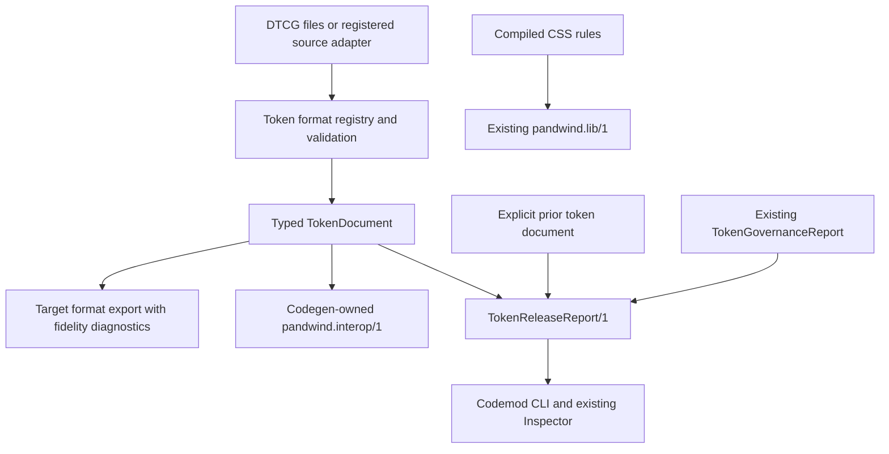
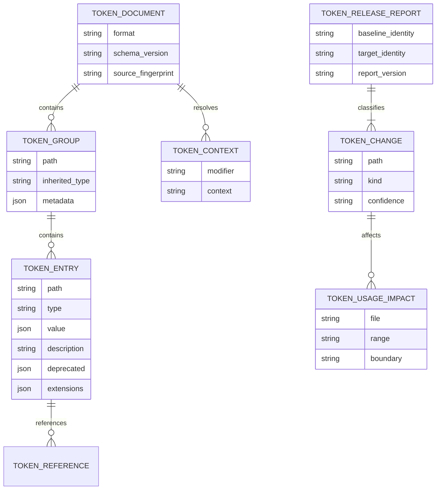

# Token interchange and release governance plan

Status: complete (2026-09-27)

## Context

- Pandwind already models raw, semantic, scope, and component tokens, including
  aliases and condition-scoped values. `define.tokens`, preset codegen, theme
  emission, token analysis, and the Inspector provide a strong internal path.
- At planning time, the token format registry supported DTCG, Style Dictionary,
  Figma Tokens, Panda, presets, CSS variables, and StyleX through a scalar-only
  `TokenSet`. The DTCG adapter flattened string `$value` fields and discarded
  rich metadata and structured values; this plan replaces that path.
- Token governance is already implemented by
  [plan 054](./054-token-usage-governance.md): the versioned report covers the
  effective token universe, provenance, scoped values, aliases, observed use,
  strictness, exact suggestions, unused-token safety, and unknown boundaries.
  This feature must reuse that report rather than recreate its analysis.
- Generated design-system context is owned by the versioned
  `pandwind.interop.json` artifact. Codegen owns its contents, and bridge
  generation refreshes its bridge section. The `pandwind.lib/1` artifact from
  [plan 071](./071-publishable-design-system-artifact.md) carries compiled CSS
  rules; it is not the source-token interchange format.
- The runtime styling API is frozen. This is a format, codegen, analyzer,
  Inspector, and codemod feature. It adds no components or runtime token API.
- The implementation target is the stable DTCG 2025.10 Format, Color, and
  Resolver modules: [Format](https://www.w3.org/community/reports/design-tokens/CG-FINAL-format-20251028/),
  [Color](https://www.w3.org/community/reports/design-tokens/CG-FINAL-color-20251028/),
  and [Resolver](https://www.w3.org/community/reports/design-tokens/CG-FINAL-resolver-20251028/).
  Preview drafts are not implementation targets.

## Goal

Preserve supported design-token semantics across file formats and generated
package metadata, then report release changes against actual consumer usage
without changing Pandwind's runtime styling APIs.

## What

Deliver two connected capabilities:

1. A typed, loss-aware token document model that can faithfully import and
   export DTCG 2025.10 data, including hierarchical groups, inherited types,
   structured values, aliases/references, descriptions, deprecation metadata,
   extensions, and resolver sets/modifiers. Conditional values remain
   contextual; import must not flatten them into invented token names.
2. A release-diff report that compares an explicitly selected baseline token
   document with the current design system and joins the changes to the
   existing token-governance report for the consumer project.

The DTCG file remains the interoperable file format at external tool
boundaries. Generated project context and tokens share the existing
`pandwind.interop/1` artifact; tokens have no separate schema or artifact.
Other registered format adapters remain available, but each must report what
it preserves and must reject unsupported lossy exports by default.

## Why

Today a conversion may succeed while discarding token meaning. A scalar-only
intermediate model cannot faithfully carry standard token types, structured
values, descriptions, deprecation state, or context resolution between tools.
That makes conversion unsafe as a source-of-truth workflow.

The existing governance report answers what a project currently defines and
uses. It does not compare published design-system revisions or show how a
release change affects consumer usage. Combining a faithful token document
with that existing report closes this gap without adding another analysis
system.

## How

### Conceptual model

Keep authored token documents, generated Pandwind context, and compiled CSS
rules as separate contracts:

`TokenDocument` preserves the authored tree and context model. Resolution is
an explicit operation that selects a resolver context; the unresolved source
remains available for export and audit. CSS lowering is separate and only
emits values that the existing preset/compiler can represent safely.

### Operations / behavior

1. **Validate** a token document against its declared format and supported
   version. Report the exact source path for invalid or unsupported values.
2. **Import/export** through registered adapters. Return a fidelity result
   describing preserved, transformed, and unsupported semantics. Never drop a
   value or metadata field silently. Export that would lose information fails
   unless the caller explicitly requests lossy output; that output includes a
   machine-readable loss report.
3. **Generate context** from codegen into `pandwind.interop.json`. Codegen
   owns the token snapshot and its provenance. Bridge generation updates only
   bridge-owned data and preserves or regenerates the token section from the
   same authoritative inputs.
4. **Compare releases** using an explicit baseline file or prior interop token
   snapshot. Classify additions, value/type/context changes, deprecations, and
   removals. Treat a path change as remove-plus-add unless the source contains
   an explicit replacement reference; do not infer renames from similar
   values.
5. **Explain impact** by joining changed token paths and aliases with the
   existing consumer usage report. Keep dynamic, public-export, generated, and
   unresolved boundaries visible. Reuse existing exact token suggestions;
   do not add a second raw-to-token heuristic.
6. **Propose migration** as a reviewable diff only when replacement semantics
   are exact and unambiguous. Removal and source edits remain read-only unless
   the caller explicitly requests write mode.

### Tech choices

| Choice                     | Decision                                                                             | Rationale                                                                                                                                                     |
| -------------------------- | ------------------------------------------------------------------------------------ | ------------------------------------------------------------------------------------------------------------------------------------------------------------- |
| Canonical exchange         | DTCG 2025.10 Format, Color, and Resolver modules                                     | Use stable, tool-neutral contracts instead of inventing a second authored token format.                                                                       |
| Internal representation    | Replace the scalar-only `TokenSet` with a versioned typed document model             | Keep hierarchy, metadata, references, structured values, and contexts intact.                                                                                 |
| Generated project artifact | Keep token context in the existing `pandwind.interop/1` envelope                     | The repo already assigns generated design-system context to this artifact. Do not use the compiled-rule `pandwind.lib/1` or create a parallel token artifact. |
| Existing source adapters   | Declare import/export fidelity and validation per adapter                            | DTCG can be lossless first; other formats must state limits instead of pretending to preserve all semantics.                                                  |
| Release identity           | Use canonical token paths; only recognize renames from explicit replacement metadata | Similar names or values do not prove token identity.                                                                                                          |
| Release analysis           | Add a separate versioned `TokenReleaseReport/1` and consume `TokenGovernanceReport`  | Keep current-project usage analysis authoritative and avoid overloading its report contract.                                                                  |
| Runtime behavior           | No runtime API changes                                                               | Token exchange and release analysis stay in tooling and generated artifacts.                                                                                  |

### Architecture

- The format registry owns detection, validation, import/export, and fidelity
  declarations. Adding a format does not add a branch to a central runner.
- A schema-validated `TokenDocument` is the shared neutral model. Its token
  values use tagged standard types; extensions retain JSON-compatible data
  under their original namespace.
- The DTCG adapter preserves unresolved references and resolver contexts. A
  separate resolver produces an explicitly selected context view; CSS
  compilation consumes only representable scalar values.
- Codegen serializes generated token context into `pandwind.interop/1` and
  owns the complete artifact. `pandwind.lib/1` continues to carry extracted
  rules only.
- The release comparator accepts an explicit baseline and current document,
  then joins the change set to the existing project-root governance report.
  Cross-repository consumers are analyzed only when their roots are explicitly
  supplied; no ambient filesystem or package-registry discovery is added.
- The CLI composes filesystem reads, registry assembly, and reporting. The
  Inspector displays the resulting evidence using its existing token and
  governance surfaces.

## What this allows

- Semantically faithful DTCG import/export for the stable supported contract,
  including typed structured values and theme/context data.
- Explicit, reviewable fidelity guarantees for every existing token format.
- Reproducible generated token context for Pandwind package consumers.
- Release diffs that show changed tokens, affected source usages, and unknown
  boundaries together.
- Safe upgrade proposals that reuse existing token-matching and removal
  policies.

## What this does not allow

- New `tw()`, `css()`, `cx()`, preset, component, or runtime token APIs.
- A component library, recipe system, or broader styling surface.
- Live Figma/API synchronization, a hosted token service, or automatic remote
  package discovery.
- Silent loss of token metadata, silent flattening of contexts, or guessed
  token renames.
- Automatic token deletion or source migration by default.
- A claim that dynamic or unscanned consumer usage is known.
- Full-fidelity export for every legacy format in the first implementation;
  unsupported cases must instead be explicit and fail closed.
- Implementation of the DTCG preview drafts while they remain unstable.

## UI & UX

### Desktop

Keep interaction in the existing codemod CLI and Inspector. Validation and
release comparison are read-only by default. Reports show source locations,
changed fields, affected token usages, fidelity losses, and unknown coverage
next to the relevant token path. Do not create a new Studio or token-editor
surface for this work.

### Mobile

Not applicable. This feature targets repository and package workflows.

### Common interactions

| Action                          | Result                                                                                                                   |
| ------------------------------- | ------------------------------------------------------------------------------------------------------------------------ |
| Validate a token file           | Format and version diagnostics identify invalid or unsupported paths; source remains unchanged.                          |
| Export to a target format       | Supported semantics are emitted; a lossy export is refused unless explicitly requested and accompanied by a loss report. |
| Compare against a prior release | Added, changed, deprecated, and removed paths appear with current consumer usages and confidence boundaries.             |
| Inspect a changed token         | Inspector shows provenance, context/alias relationships, use sites, and any unresolved impact.                           |
| Request a migration proposal    | Exact, unambiguous replacements appear as a reviewable diff; no edits happen without write mode.                         |

## Data model

The concrete TypeScript contracts must use tagged, schema-validated value
variants. JSON values are allowed only for DTCG extension payloads and opaque
source metadata whose owning adapter does not interpret them.

## Implementation steps

1. [x] Audit current format adapters and representative DTCG documents. Record
       exactly which paths, types, metadata, references, and contexts each adapter
       currently drops or transforms.
2. [x] Define the versioned `TokenDocument`, typed values, context model, format
       fidelity result, and `TokenReleaseReport/1`. Add registry substitution tests
       with a minimal fake format adapter.
3. [x] Implement DTCG 2025.10 validation and lossless import/export for groups,
       inherited types, `$root`, scalar and structured values, references,
       `$description`, `$deprecated`, `$extensions`, sets, and modifiers.
4. [x] Separate source preservation from explicit context resolution and CSS
       lowering. Keep unsupported CSS lowering as a structured diagnostic while
       retaining the token document intact.
5. [x] Migrate existing format adapters to the richer model. Add fidelity fixtures
       for each adapter; refuse unsupported lossy exports by default. Improve
       individual formats only where real project needs justify the work.
6. [x] Generate token context inside the existing `pandwind.interop/1` envelope
       from codegen-owned inputs and provenance. Keep the root schema authoritative,
       update readers and bridge generation atomically, and regenerate checked-in
       artifacts.
7. [x] Implement baseline comparison and join it with the existing governance
       report. Cover aliases, conditions, deprecations, removal safety, exact
       replacements, public exports, and dynamic/unknown boundaries.
8. [x] Surface validation, export fidelity, and release impact through existing
       CLI and Inspector surfaces. Add consumer documentation and a real package
       fixture for publish/consume/upgrade behavior.

## Resolved questions

1. Keep a repo-owned fixture suite derived from the DTCG 2025.10 Format,
   Color, and Resolver reports and validate the Resolver version against the
   official schema. The fixtures test supported semantics without claiming to
   be an official conformance corpus.
2. No additional legacy rich-value export is justified by a documented
   consumer need. Keep each adapter's fidelity declaration explicit and reject
   lossy output unless the caller opts in.
3. Accept any registered token format as an explicit baseline (`dtcg` by
   default, configurable with `--release-format`). Read the current release
   only from the validated token section of `pandwind.interop/1`. This keeps
   authored baseline files separate from generated current-project metadata.

## Acceptance criteria

- [x] DTCG 2025.10 valid documents round-trip semantically without losing
      hierarchy, standard metadata, supported typed values, references,
      extensions, or resolver contexts.
- [x] Invalid structures and unsupported values produce path-specific
      diagnostics; no input is silently skipped or flattened.
- [x] Context-dependent values remain contextual unless an explicit resolver
      context is selected.
- [x] Every registered format adapter declares its supported fidelity, and
      lossy exports fail by default with a machine-readable explanation.
- [x] Codegen owns and deterministically writes the token section of
      `pandwind.interop/1`; bridge generation refreshes only bridge-owned data
      or regenerates the full artifact from authoritative inputs.
- [x] `pandwind.lib/1` remains the compiled CSS-rule artifact and is not used
      as the token interchange contract.
- [x] `TokenReleaseReport/1` identifies additions, changes, deprecations, and
      removals and links them to existing usage/provenance evidence.
- [x] Potential renames are not guessed; exact replacement suggestions reuse
      current token policies and preserve unknown boundaries.
- [x] Analysis stays read-only by default and supports explicit consumer roots
      without ambient repository or registry scans.
- [x] No runtime authoring API, component surface, or duplicate governance
      subsystem is introduced.
- [x] Documentation distinguishes token-file portability, generated
      interop metadata, and compiled CSS artifacts.

## Decisions log

| Date       | Decision                                                                                      | Rationale                                                                                                                    |
| ---------- | --------------------------------------------------------------------------------------------- | ---------------------------------------------------------------------------------------------------------------------------- |
| 2026-09-27 | Treat scalar-only format conversion as the portability gap                                    | Pandwind already has themes, token layers, and current-project usage governance.                                             |
| 2026-09-27 | Use stable DTCG 2025.10 modules as the external fidelity target                               | They cover token format, color values, and multi-context resolution without a Pandwind-specific authored format.             |
| 2026-09-27 | Extend the codegen-owned interop artifact instead of adding a second generated token artifact | Repository policy assigns generated design-system context to `pandwind.interop.json`; `pandwind.lib/1` remains compiled CSS. |
| 2026-09-27 | Add a separate release diff that consumes the existing governance report                      | Current usage analysis is complete; release comparison is the missing layer.                                                 |
| 2026-09-27 | Keep all behavior in tooling and preserve the frozen runtime API                              | Interchange, fidelity, and release impact do not require new styling syntax.                                                 |
| 2026-09-27 | Keep components and live design-tool sync out of scope                                        | They expand product breadth without closing the identified token-contract gap.                                               |
| 2026-09-27 | Pin repo-owned fixtures to the official DTCG reports and 2025.10 Resolver schema              | The fixtures are deterministic and spec-derived without claiming an external conformance suite.                              |
| 2026-09-27 | Keep registered token files as baselines and `/3` interop snapshots as current state          | Each side has one explicit format contract and current metadata stays codegen-owned.                                         |
| 2026-09-27 | Restrict Resolver file references to real paths inside the invocation project root            | Relative references remain useful while remote, traversal, absolute-outside-root, and symlink escapes are rejected.          |
| 2026-09-27 | Put Inspector export and release review in the existing usage/cleanup surface                 | Token governance improves without adding a design-system component or another navigation area.                               |
